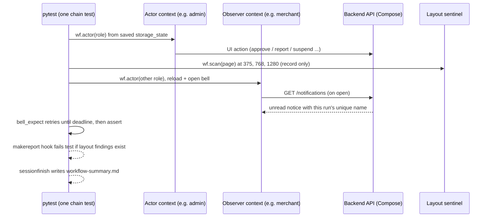

# Slice: S-125 — Cross-role workflow chains + layout sentinel (manual GitHub workflow)

| Field | Value |
|-------|-------|
| **Slice ID** | S-125 |
| **Phase** | 5 Polish |
| **Status** | Specified |
| **Role(s)** | customer, merchant, admin (as actors in tests); maintainer (as the person who dispatches the run) |
| **Owner** | PM / 2026-11-08 |

---

## Context

Slice 2 of a two-slice plan. This slice is **test tooling only**: no app, backend, or
frontend product code changes. The customer-notification features (notify the review author
of a reply / hide, notify on shop update) are a **separate later slice**; chain tests that
depend on them are recorded here as **known gaps, not failures**.

Today the S-010 / S-124 Playwright layer (`backend/tests/e2e/`) drives one role at a time. No
test opens a second role's browser to confirm what that person saw, and no test touches the
notification bell (see README §11 "Cross-role workflow chains"). Nothing checks page layout
(overlap, clipping, horizontal scroll) at phone / tablet / desktop widths.

Decisions locked by the owner (final):

- New workflow `.github/workflows/web-workflows.yml`, **`workflow_dispatch` only** — no
  `push`, no `pull_request`, no `schedule`, never a required check, no git hooks. (This
  supersedes the "nightly `schedule`" wording currently in README §11; README is reconciled
  in this slice.)
- Existing suite (S-010 / S-124) and `web-e2e.yml` keep working unchanged.
- Bell semantics: one row per `(user, scenario)`, overwritten and marked unread on a new
  event — assert **unread + latest text**, never row counts.

---

## User story

**As a** maintainer of MerchantHub AI
**I want** to manually dispatch a GitHub workflow that replays real cross-role journeys
(one actor acts, a different role confirms in their own browser) and checks every visited
page for layout defects at three screen widths
**So that** I can prove, on demand and before release, that what one role does reaches the
other role's screen and that no page is visually broken on phone, tablet, or desktop — with
a readable pass/fail table and downloadable traces, without ever blocking a merge

---

## Acceptance criteria

Every AC is verifiable by the Tester via a named automated test or workflow-run evidence
recorded in `TR-S-125`. Each numbered item maps one-to-one to a named test / evidence entry.

### A — Workflow trigger and run hygiene

1. **Given** `.github/workflows/web-workflows.yml`, **when** its triggers are inspected,
   **then** the only trigger is `workflow_dispatch`; it has no `push`, `pull_request`, or
   `schedule` key, no deploy step, and no git hook was added or changed.
2. **Given** the Run workflow form, **when** a maintainer opens it, **then** it offers the
   native branch selector, a `suite` choice whose options are exactly `all`, one value per
   chain (`wf-listing-approval`, `wf-new-review`, `wf-featured-boost`, `wf-suspend`,
   `wf-review-moderation`, `wf-review-reply`, `wf-shop-edit`, `wf-whatsapp-draft`), and
   `layout`, plus an optional free-text extra-pytest-args input.
3. **Given** any `suite` value, **when** the workflow runs, **then** only the selected
   chain(s) / layout tests execute (`all` runs every chain plus layout), and extra pytest
   args, if supplied, are appended to the pytest command.
4. **Given** any run (passing or failing), **when** it ends, **then** the Compose stack
   was started fresh for this run and is torn down with `down -v` (including on failure /
   cancellation), so no data carries over between runs.
5. **Given** any run, **when** it ends, **then** these are attached as downloadable
   artifacts: `playwright-traces`, the pytest log, and the Compose logs.
6. **Given** a run that executed one or more chains, **when** the job finishes, **then** the
   GitHub job summary shows a table with one row per chain (chain id, status
   PASS / FAIL / KNOWN-GAP / SKIPPED, and reason for non-PASS) — and it is produced even
   when tests fail.
7. **Given** the existing `web-e2e.yml`, S-010 `test_flow_*`, and S-124 `journeys/`, **when**
   S-125 is merged, **then** `web-e2e.yml` is byte-unchanged except where explicitly noted
   in the PR, and the existing suite still collects and (when dispatched with `suite=all`)
   still passes; default `cd backend && pytest` still skips all e2e tests and launches no
   browser; `pytest_collection_modifyitems` and `e2e_trace` are untouched.

### B — Deterministic accounts and role sessions

8. **Given** a fresh e2e stack, **when** the chain tests start, **then** fixed seeded
   admin, merchant, and customer accounts exist with a known TOTP secret, and the stack
   needs no manual setup beyond what the workflow does.
9. **Given** the three seeded accounts, **when** the first chain test of a run needs a
   role, **then** that role is signed in **once per run through the real login page**
   (email, password, TOTP step), its browser `storage_state` is saved, and every later test
   in the run reuses it rather than logging in again.
10. **Given** a chain test, **when** it runs, **then** it is a single pytest test using one
    separate browser context per role involved (never two roles in one context), and each
    context starts authenticated from that role's saved `storage_state`.
11. **Given** any chain, **when** it creates data, **then** every actor / entity it creates
    (extra users, businesses, reviews) carries a per-run unique suffix via the existing
    helpers, and no chain depends on state left by another chain.
12. **Given** a cross-role assertion, **when** the second role's page has not yet shown the
    effect, **then** the assertion waits and retries up to a bounded timeout (no fixed
    sleeps, no bare `networkidle`) and only fails after the timeout.

### C — Chains buildable now

13. **`wf-listing-approval`** — **Given** a merchant creates a business through the UI,
    **when** the admin approves it in their own browser, **then** (a) the merchant's
    notification bell shows an **unread** "Listing approved" item, and (b) searching for the
    business name as a customer shows it. *(Customer-search visibility may be asserted via
    the business profile page if search cache staleness makes the search result flaky; the
    Architect documents which.)*
14. **`wf-new-review`** — **Given** an approved business owned by a seeded/created merchant,
    **when** a customer posts an N-star review in their browser, **then** the merchant's bell
    shows an **unread** item whose text reads "New N-star review" for that N, and the
    merchant dashboard lists that review.
15. **`wf-featured-boost`** — **Given** a stack with `DEBUG=true` and an approved business,
    **when** the merchant completes the featured-boost mock payment, **then** the merchant
    bell shows unread "Featured payment received"; **when** the admin then approves the
    boost, **then** the merchant bell shows unread "Featured boost is live". If `DEBUG` is
    not true the test is **SKIPPED with reason**, not failed.
16. **`wf-suspend`** — **Given** a throwaway customer, **when** the admin suspends them in
    the admin browser, **then** that customer cannot log in (the login attempt shows an
    error / is refused and no session is created).
17. **`wf-review-moderation`** — **Given** a customer's review visible on a public business
    page, **when** the customer reports it and the admin hides it, **then** a reload of the
    public business page (anonymous or customer context) no longer shows that review.

### D — Chains partly blocked by product gaps (recorded, not failed)

18. **`wf-review-reply`** — **Given** a merchant replies to a customer's review, **then**
    the reply appears on the public business page (this part runs and must pass); the
    assertion that the customer is **notified** is recorded as `xfail` / known-gap with the
    reason "customer is not notified of replies (README §14)", and shows in the summary as
    KNOWN-GAP, not FAIL.
19. **`wf-shop-edit`** — **Given** a merchant edits their business, **then** the edit is
    visible on the public business page immediately (this part runs and must pass); the
    assertion that anyone is **notified** is recorded as known-gap with reason "business
    edits notify nobody (README §14)", shown as KNOWN-GAP.
20. **`wf-whatsapp-draft`** — **Given** seeded WhatsApp drafts exist, **when** the admin
    approves one, **then** the merchant bell shows unread "applied" notice; **given** no
    seeded drafts exist, **then** the test is SKIPPED with a human-readable reason.
21. **Given** a known-gap `xfail`, **when** the underlying product gap is later fixed and
    the assertion starts passing, **then** the run surfaces it (strict xfail or an explicit
    XPASS note in the summary) so the gap record is updated rather than silently rotting.

### E — Layout sentinel

22. **Given** a reusable Playwright layout-check helper, **when** it runs on a page at a
    given viewport width, **then** it reports a finding for each of: (a) horizontal page
    scroll (document wider than the viewport); (b) two interactive or text elements whose
    bounding boxes intersect where neither contains the other; (c) text clipped by its
    container; (d) an interactive element positioned horizontally outside the viewport.
23. **Given** the helper, **when** it is wired into the chain tests, **then** it runs on
    **every page visited by a chain test** at **375, 768, and 1280** px widths (viewport
    resized per check, original restored after).
24. **Given** a finding, **when** it is reported, **then** it includes the page URL / route,
    the viewport width, the rule violated, and — for overlap — the identity of **both**
    overlapping elements (accessible name / tag + text snippet), and it fails the test (or
    the layout-suite test) with that detail in the message.
25. **Self-test, detects:** **Given** a deliberately broken **static fixture page** (known
    horizontal overflow, two overlapping buttons, a clipped text block, and an off-screen
    button), **when** the helper runs on it at each width, **then** it reports every one of
    those four defect classes (self-test passes only if all are detected).
26. **Self-test, passes clean:** **Given** a clean static fixture page, **when** the helper
    runs on it at all three widths, **then** it reports zero findings.
27. **Given** the self-test, **when** it runs, **then** it needs no Compose stack, backend,
    or seeded data (static HTML only) and is selectable via `suite=layout`.
28. **Given** layout findings in a chain run, **when** the job summary is written, **then**
    it lists every finding (page, viewport width, the two overlapping elements / the rule) —
    "No layout findings" when empty — in addition to the chain table in AC 6.

### F — Documentation (same PR)

29. **Given** the PR, **when** reviewed, **then** README §11 has (a) a feature → test index
    row for the chains + layout files, (b) the "Cross-role workflow chains" subsection
    updated: status flipped from **Not built** to **implemented** per chain actually built
    (known-gap chains marked partial), the "nightly `schedule`" / "optionally one GitHub
    issue" wording removed to match manual-only, and "How to run" / GitHub-manual text
    mentions `web-workflows.yml`; and (c) a §14 row stating the new manual workflow and the
    chains recorded as known gaps. No new `.md` files outside `docs/agents/`.

---

## UX notes

- **Not a product UI slice.** No new route, screen, nav entry, or component; no change to
  existing ones.
- **No Figma frame.** Nothing renders to `MerchantHub AI — Mobile`
  (`rk4RnruVFTpKdIsgGJIt9w`) or any design surface. No mobile placement; no mobile parity.
- **No README §12 parity row** (test infrastructure, consistent with S-010 / S-124). If the
  Builder is forced to touch product code to make a selector workable, stop and re-scope —
  that is outside this slice's decision.
- "UX" here is the maintainer's experience on GitHub: **Actions → Run workflow** form
  (branch, suite, extra args) -> job summary (chain table + layout findings list) ->
  downloadable `playwright-traces`, pytest log, compose logs. Failure messages must be
  readable by a beginner: name the chain, the step, and what was expected on whose screen.
- Notification wording asserted in tests must match live copy: "Listing approved",
  "New N-star review", "Featured payment received", "Featured boost is live". Copy drift
  fails the chain loudly (intended canary).
- AI disclaimer required? **No** — no AI surface added.

---

## Out of scope

- **Customer-notification features** (notify the author of a reply, of a hide / remove, or
  of a shop update). They are a separate later slice; here those chain assertions are
  recorded as known gaps (AC 18, 19), not failures.
- Any app, backend, or frontend product code change; any migration; any API change.
- `push`, `pull_request`, or `schedule` triggers; making the workflow a required check;
  branch protection; git hooks; auto-filed GitHub issues.
- Visual-regression / screenshot diffing; accessibility (WCAG) audit; performance / load.
- Running the layout sentinel on pages **not** visited by a chain test (the existing S-124
  journeys are not retrofitted).
- Mobile (`mobile/`) emulator tests or mobile layout checks.
- Live vendors (Google OAuth, real email / payments); stack stays on mocks.
- Changing, replacing, or re-timing `web-e2e.yml`, S-010 flows, or S-124 journeys.
- Hosted staging (Railway) runs.

---

## Dependencies

- **S-124** — human predefined-value e2e catalogue (pytest/Playwright harness, `conftest.py`
  fixtures, `api_client.py`, page objects, `web-e2e.yml` pattern incl. the bind-mount fix).
  Must stay green and unchanged in behaviour. **Status: Testing, tests Pass; PM acceptance
  pending** — treat as a soft dependency (reuse its code; do not modify it).
- **S-010** — Playwright harness and ADR-009 (toolchain fixed: Playwright for Python; no
  Cypress / Selenium; no new ADR expected).
- **Notification scenarios** already built (`listing_approved`, `new_review`,
  `payment_captured`, `payment_boost_approved`, `whatsapp_applied` / `whatsapp_rejected`) —
  the chains consume them as-is.
- **Backend `services/mfa.enable_demo_totp`** — existing; used for deterministic TOTP on the
  e2e stack seed (reuse, do not change product behaviour).
- Compose stack with mock AI / email / payments and `DEBUG=true` available to the workflow
  (only `wf-featured-boost` needs `DEBUG=true`).
- Follow-up slice (not a dependency): customer-notification features, which will convert
  AC 18 / 19 known-gap assertions into passing assertions.

---

## Definition of done (PM)

- [ ] AC 1–29 each mapped to a named passing test, or a workflow-run link, or an explicit
      KNOWN-GAP / SKIPPED-with-reason entry (ACs 15, 18-20) in `TR-S-125`, with an
      AC-coverage matrix.
- [ ] At least one real `workflow_dispatch` run on GitHub with `suite=all` recorded in
      `TR-S-125` (run URL, per-chain table, layout findings) and one `suite=layout` run.
      Findings the sentinel surfaces on the real app are **listed in the TR as product
      follow-ups**, not fixed in this slice.
- [ ] `web-e2e.yml` unchanged; default `pytest` still skips e2e; S-124 `suite=all` still
      green.
- [ ] `web-workflows.yml` has only `workflow_dispatch`; no hooks added.
- [ ] No product code (app/backend/frontend/mobile) in the diff.
- [ ] README §11 index row + "Cross-role workflow chains" subsection reconciled (including
      removal of the nightly `schedule` wording), §14 row added; status mirrored consistently
      everywhere it appears (§11, §14; §16 not needed - not investor-visible). No §12 row.
- [ ] Code on a feature branch + PR (never committed on `main`).
- [ ] PM sets `Status: Accepted` after `TR-S-125` shows all AC passing or recorded as
      known-gap / skipped with reason.

---

## Technical specification (Architect)

> Tooling-only slice. Everything below is test-tooling design under `backend/tests/e2e/`,
> `backend/pytest.ini`, and `.github/workflows/`. No `app/`, `frontend/`, or `mobile/` file
> changes. If a selector cannot be made to work without a product edit, **stop and re-scope**
> (do not edit product code).

### API contract

**None.** No endpoint is added, changed, or removed. The chains *consume* existing endpoints
only (all already in README §7): `auth/login`, `auth/mfa/totp/verify|confirm`, `auth/refresh`,
`auth/reauth`, `auth/me`, `businesses` (create/approve/`mine`/`id`/PATCH), `reviews`
(create/report/moderate/reply), `payments/featured/*`, `payments/mock/complete`,
`payments/admin/payments/{id}/approve`, `admin/users/{id}/suspend|reactivate`,
`admin/whatsapp/drafts*`, `notifications`.

### RBAC matrix

No RBAC change. Roles act as **test actors** only:

| Action (as actor) | customer | merchant | admin | anonymous |
|-------------------|----------|----------|-------|-----------|
| Seeded account used (one real UI login per run) | `customer@example.com` | `merchant@example.com` | `admin@merchanthub.ai` | — |
| Creates data (per-run unique names) | review author / reporter | business (via UI or API), reply, edit | approves, hides, suspends | — |
| Fresh per-chain accounts (`register` API, no UI login) | `wf-suspend` target, review authors | none | none | — |

### Data model impact

- [x] None  [ ] Extend existing  [ ] New table(s)

**Details:** No schema, enum, or migration change; no ERD change. The chains write ordinary
rows (users, businesses, reviews, payments, notifications) into a throwaway Compose database
that is destroyed with `docker compose down -v`.

### Cache / side effects

- No product cache code touched. Chains *rely on* existing behaviour:
  `cache_delete_pattern("search:*")` already runs on business approve
  (`routers/businesses.py:436`), PATCH (`:361`), review create (`routers/reviews.py:220`),
  and featured approve (`services/payments/featured.py:141`). Verified in code, so a search
  immediately after approve is **not** stale (see `wf-listing-approval`).
- Side effects of running chains on a stack: notification rows (one per `(user, scenario)`,
  overwritten), mock emails (logged only), mock AI analyses. All discarded by `down -v`.
- Browser traces and auth state: traces go to `backend/tests/e2e/test-results/` (already
  gitignored, uploaded as `playwright-traces`). Saved role `storage_state` files contain JWTs
  and are written to a **pytest temp dir outside the repo and outside `test-results/`** so
  they are never uploaded or committed.

### Frontend

- **Route:** none added. Existing routes driven: `/login`, `/merchant/dashboard`,
  `/merchant/businesses/new`, `/merchant/businesses/{id}/edit`, `/admin`,
  `/businesses/{slug}`, `/businesses/{slug}/review`, `/search?q=`.
- **Rendering:** unchanged (SSR public pages, CSR dashboards). Because `/businesses/{slug}`
  and `/search` are SSR, the chains assert on them by **reload-retry** of the page, not by
  network-log inspection (README §11 SSR caveat).
- **Components:** none changed. Reused page objects (`backend/tests/e2e/pages/`):
  `LoginPage`, `NewBusinessPage` (`merchant.py`), `EditBusinessPage` (`business_form.py`),
  `MerchantDashboardPage` (`merchant_dashboard.py`: `start_featured_checkout`,
  `reply_to_first_review`), `AdminPanelPage` (`admin_panel.py`: `start_review_then_approve`,
  `moderate_reported`, `toggle_user`), `BusinessDetailPage`. Reused helpers: `Api`,
  `unique_email`, `unique_name`, `REVIEW_BODY`, `REPORT_REASON`, `PASSWORD`,
  `inject_session`.

### Test-tooling design (S-125)

#### 1. File layout (all new files; nothing existing is renamed or moved)

```
backend/tests/e2e/
  layout_sentinel.py                 # pure function check_layout(page, ...) -> list[dict]
  test_layout_sentinel_selftest.py   # static-HTML self-test; no stack; no E2E=1 needed
  fixtures/
    layout_clean.html                # must yield 0 findings at 375/768/1280
    layout_broken.html               # must yield all 4 rule classes at 375/768/1280
  chains/
    __init__.py
    conftest.py                      # session/function fixtures + 2 pytest hooks (below)
    helpers.py                       # Wf helper class, bell_expect, eventually, setup helpers
    summary.py                       # WorkflowSummary: classify + render summary markdown
    test_wf_listing_approval.py
    test_wf_new_review.py
    test_wf_featured_boost.py
    test_wf_suspend.py
    test_wf_review_moderation.py
    test_wf_review_reply.py          # main test + test_wf_review_reply_gap (xfail strict)
    test_wf_shop_edit.py             # main test + test_wf_shop_edit_gap   (xfail strict)
    test_wf_whatsapp_draft.py
.github/workflows/web-workflows.yml
backend/pytest.ini                   # +2 markers only (additive)
backend/tests/e2e/conftest.py        # +1 additive early-continue in the collection hook (below)
```

Conventions: chain id = filename with `test_` stripped and `_` -> `-` (`test_wf_new_review.py`
-> `wf-new-review`). The main test is `test_wf_<id>`; a known-gap test is `test_wf_<id>_gap`.
Every chain module sets `pytestmark = [pytest.mark.e2e, pytest.mark.slow,
pytest.mark.workflow_chain]`. Chains run **serially** (no `-n`/xdist: the summary registry
and the bell-row overwrite rule both assume one process).

**Gate escape for the self-test (decided).** Add marker `layout_selftest` to `pytest.ini`
(`layout_selftest: layout sentinel self-test on static HTML (no Compose stack, no E2E=1)`,
plus `workflow_chain: cross-role workflow chain (S-125)`). In
`conftest.pytest_collection_modifyitems` add, as the first line inside the `for item in
items:` loop, `if item.get_closest_marker("layout_selftest"): continue`. The self-test module
sets `pytestmark = pytest.mark.layout_selftest` and does **not** carry `e2e`. This is purely
additive: every existing test still hits the unchanged skip path, `e2e_trace` is untouched.
**AC 7 reconciliation:** AC 7 says the hook is "untouched" while AC 27 requires a self-test
runnable without `E2E=1`; the two cannot both hold literally, so the Tester verifies the
intent: *behaviour for every pre-existing test is byte-identical* (default `pytest` still
skips all of S-010/S-124/chains and starts no browser for them). The only default-run cost is
the two-three self-test functions, which launch Chromium via a **self-managed**
`sync_playwright()` fixture (not the `page` fixture) and `pytest.skip("chromium not
installed: playwright install chromium")` if launch fails, **unless** env
`LAYOUT_SELFTEST_REQUIRE_BROWSER=1` (set by the workflow) is present, in which case a launch
failure is a hard error. So a laptop or `backend-tests.yml` without browsers stays green and
the workflow can never silently skip the sentinel proof. PM to confirm the AC 7 wording
tweak on acceptance.

#### 2. Layout sentinel (`layout_sentinel.py`)

Public API:

```python
WIDTHS = (375, 768, 1280)
HEIGHTS = {375: 812, 768: 1024, 1280: 800}
def check_layout(page, *, widths=WIDTHS, label="", ignore_selectors=()) -> list[dict]: ...
def check_layout_at(page, width, *, ignore_selectors=()) -> list[dict]: ...  # no restore
```

`check_layout` records `orig = page.viewport_size or {"width":1280,"height":720}`; for each
width calls `page.set_viewport_size({"width": w, "height": HEIGHTS[w]})`, then waits for the
layout to settle with **no sleep**: `page.evaluate("() => document.fonts.ready.then(() =>
new Promise(r => requestAnimationFrame(() => requestAnimationFrame(r))))")`, scrolls
`window.scrollTo(0,0)`, runs the module-level `_JS` string via `page.evaluate(_JS, args)`, tags
each finding with `url` (path+query, no host), `width`, `label`; and in a `finally` restores
`orig`. It never raises on findings and never navigates. Pure with respect to the app (read-only
DOM inspection).

Finding shape (JSON-serialisable dict):
`{"rule", "url", "width", "label", "detail", "a": {"tag","name","text","path"}, "b": {...}|None}`.
`name` = `aria-label` || `alt` || `placeholder` || `value` || first 40 chars of `innerText`;
`path` = `tag#id.class1.class2` (max 3 classes) plus `:nth-of-type`. Rule ids are fixed
strings: `horizontal-scroll`, `overlap`, `clipped-text`, `offscreen-interactive`.

Candidate sets (computed in JS):
- **Interactive**: `a[href], button, input:not([type=hidden]), select, textarea, summary,
  [role=button|link|tab|menuitem|checkbox|switch], [tabindex]:not([tabindex="-1"])`; rect =
  `getBoundingClientRect()`.
- **Text**: any element with at least one direct child text node with non-whitespace text,
  excluding `script,style,noscript,template,option,svg *`; rects = `Range` over those direct
  text nodes `.getClientRects()` (one rect per line box).
- Both: must pass `el.checkVisibility({checkOpacity:true, checkVisibilityCSS:true})`, no
  `aria-hidden="true"` / `inert` / `[hidden]` ancestor, not under any `ignore_selectors`
  match, and at least one rect with width >= 2 and height >= 2 (drops `sr-only` 1px
  elements). Cap at 3000 candidates per page (truncate, add a `note` finding-less warning
  string to the return list's side channel `check_layout.last_truncated`).

Rules and thresholds (constants at top of module so they are reviewable):
1. **horizontal-scroll**: `document.documentElement.scrollWidth > window.innerWidth + 1`.
   Detail: `scrollWidth=X innerWidth=Y` plus up to 3 widest offenders (visible elements whose
   `rect.right > innerWidth + 1`, with `name`/`path`). One finding per page+width.
2. **overlap** (pairs of candidates `a`, `b`, interactive or text, either kind): reported
   only if ALL hold: both visible per above; neither `a.contains(b)` nor `b.contains(a)`
   (so a label inside its button is never a pair); some rect of `a` and some rect of `b`
   intersect with intersection width >= 2px AND height >= 2px AND area > `OVERLAP_MIN_AREA`
   = 16 px² AND area >= 5% of the smaller of the two rects (kills sub-pixel kisses and
   negative-margin borders). Implemented as a sweep over rects sorted by `top` (O(n log n)
   typical). Dedupe per unordered pair; max 20 overlap findings per page+width (a `+N more`
   note is added to the 20th finding's detail). Detail:
   `"<a.name>" (<a.path>) overlaps "<b.name>" (<b.path>) by <w>x<h>px`; both elements are
   populated in `a` and `b` (AC 24).
   **Fixed/sticky exemption (justified, narrow):** let `fixedRoot(el)` be the nearest
   ancestor-or-self whose computed `position` is `fixed` or `sticky`. A pair is **skipped**
   iff `fixedRoot(a) !== fixedRoot(b)` (one is in a floating layer, the other is not, or they
   are in different layers). Reason: a sticky/fixed navbar, toast, or cookie bar is designed
   to float over scrolling content and would otherwise flag on every page; we measure at
   scroll 0 with no overlay open. Pairs inside the **same** fixed container, and any two
   normal-flow elements, are fully checked. Known limit (accepted): a fixed bar that
   permanently covers a normal-flow control is not reported. Dropdowns/modals are not
   exempted: the helper must be run with overlays closed (see `Wf.scan`, which presses
   `Escape` and never scans an open bell menu).
3. **clipped-text**, two sub-rules on text and interactive candidates:
   (c1) self-clip: `el.scrollWidth > el.clientWidth + 2` AND `clientWidth > 0` AND computed
   `overflow-x` in `{hidden, clip}` AND NOT (`text-overflow: ellipsis` on a non-interactive
   element). Ellipsis on an interactive element (button/link/label/summary/role=button) **is**
   reported (a truncated action label hides the action); ellipsis on passive text (card
   titles via `truncate`) is treated as intentional design and not reported. Also
   vertical: `scrollHeight > clientHeight + 2` with `overflow-y` in `{hidden, clip}` and NOT
   `-webkit-line-clamp` (non-`none`) -> reported.
   (c2) ancestor clip: for a text candidate, walk ancestors; for the first ancestor with
   `overflow-x` in `{hidden, clip}` (not `auto`/`scroll`, those are scrollable) whose rect
   cuts the text rect horizontally by more than 2px (`textRect.right > anc.right + 2` or
   `textRect.left < anc.left - 2`), report with `b` = the clipping ancestor.
4. **offscreen-interactive**: an interactive candidate with `rect.right > innerWidth + 1` or
   `rect.left < -1`, unless some ancestor (excluding `html`/`body`) has `overflow-x` in
   `{auto, scroll, hidden, clip}` (carousel rails and off-canvas drawers are intentional;
   anything clipped by an `overflow` ancestor is reported by (c2)/not at all, never
   double-counted).

`ignore_selectors` (default empty, extend only with a code comment + a TR note) is the single
escape hatch for a false positive found on the real app; it is **not** used to hide real
defects. Findings the sentinel surfaces on the real app are recorded in `TR-S-125` as product
follow-ups (PM DoD), not suppressed.

**Fixtures.** `fixtures/layout_clean.html`: `<meta viewport>`, flex-wrap row of three buttons
with gap, a paragraph, a heading, `max-width:100%` image-free layout, no fixed widths ->
0 findings at all three widths. `fixtures/layout_broken.html`: (i) `<div style="width:1500px;
height:8px">` (horizontal scroll at every width, including 1280); (ii) two `position:absolute`
buttons `left:20px;top:120px;width:140px` and `left:80px;top:130px;width:140px`, names
`Overlap A` / `Overlap B`; (iii) `<div style="width:100px;overflow:hidden;white-space:nowrap">`
containing a long sentence (clipped-text, c1); (iv) `<button style="position:absolute;
left:1400px;top:300px">Off screen</button>` (right edge > 1280 at every width). All pixel
values are absolute so the four classes appear identically at 375/768/1280.

**Self-test** (`test_layout_sentinel_selftest.py`, `pytestmark = pytest.mark.layout_selftest`):
- `test_sentinel_detects_all_four_defects`: for the broken fixture (loaded via
  `Path(...).as_uri()`), `check_layout` returns, for **each** of the three widths, findings
  covering `{horizontal-scroll, overlap, clipped-text, offscreen-interactive}`; the overlap
  finding names both `Overlap A` and `Overlap B`; every finding carries url/width/rule.
- `test_sentinel_clean_page_has_no_findings`: clean fixture -> `[]` at all three widths.
- `test_sentinel_restores_viewport`: viewport before == after (including a non-default size).
The browser comes from a module-scoped fixture using `sync_playwright()` + the launch-fail
skip/require rule in section 1.

#### 3. How the sentinel is wired into chains (`chains/helpers.py::Wf`)

A function-scoped fixture `wf` (in `chains/conftest.py`) yields a `Wf` object per test with
`chain_id`, `findings: list[dict]`, `visited: set[str]`, `scanned: set[str]`. Methods:

- `wf.actor(role)` -> Playwright `Page` in a **new browser context** created from the role's
  saved `storage_state` (roles `admin|merchant|customer`); `wf.anon()` -> context with no
  state; `wf.session_actor(access, refresh)` -> context + `inject_session(...)` for fresh
  per-run accounts. Context args = `browser_context_args` (carries `base_url`), viewport
  1280x800. Each context starts Playwright tracing and, at teardown, writes
  `test-results/<test_name>-<role>.zip` (separate from the existing `e2e_trace`, which only
  traces the stock `page` fixture and is not used by chains). A `framenavigated`
  listener adds every top-frame path to `wf.visited`.
- `wf.visit(page, path, *, ready, label="")`: `page.goto(path)`; `expect(ready)
  .to_be_visible(timeout=20_000)` where `ready` is a **required** locator (one per page,
  listed in the chain steps below); then a **best-effort, bounded** `try:
  page.wait_for_load_state("networkidle", timeout=5_000) except PlaywrightTimeoutError: pass`
  (never relied upon, never unbounded - satisfies AC 12's "no bare networkidle"); then
  `wf.scan(page, label or path)`.
- `wf.scan(page, label)`: closes any open overlay (`page.keyboard.press("Escape")`), calls
  `check_layout(page, label=label)` (375, 768, 1280, viewport restored), appends findings
  (tagged with `chain_id`) to `wf.findings`, adds the path to `wf.scanned`. Used directly for
  pages reached by client-side navigation or form submit (e.g. `/merchant/dashboard` after
  creating a business).
- **No fail-fast on findings.** `scan` only records. Failing happens in the hook below, after
  the test body has run all its functional steps.
- **Fail at end.** `chains/conftest.py` defines a `pytest_runtest_makereport` hookwrapper:
  after the `call` phase, if the report passed and `item.funcargs.get("wf")` has findings,
  set `rep.outcome = "failed"` and `rep.longrepr` to a text block, one line per finding:
  `[wf-new-review] layout: /merchant/dashboard @375px overlap: "Boost this listing" (...)
  overlaps "Reply as business" (...) by 40x12px`, preceded by the sentence
  `functional steps passed; N layout finding(s)`. A functional failure keeps its own
  traceback and the findings are still listed in the summary.
- **Teardown audit.** On `wf` teardown: findings go to `summary.REGISTRY`; any path in
  `wf.visited - wf.scanned` is added as a **warning** ("page visited but not scanned"), not a
  failure (covers redirect hops such as `/login -> /`).
- Reuse note: the gap tests (`*_gap`) and the `wf-suspend` login probe do not scan pages
  they only touch to assert absence.

Bell assertion (`helpers.bell_expect(page, *, title, contains, unread=True,
timeout_ms=45_000, chain="")`). `NotificationBell.tsx` fetches the unread **count** on mount
and every 30 s and the **list** each time the dropdown is opened (`useEffect` on `open`), and
opening does **not** mark items read (only clicking an item does). So the helper loops until
a monotonic deadline: `page.reload()`; wait for `get_by_role("button", name="Notifications")`
visible (20 s); click it; `item = page.locator("ul li button").filter(has_text=title)
.filter(has_text=contains)`; `expect(item.first).to_be_visible(timeout=4_000)`; if
`unread`, `expect(item.first).not_to_have_class(re.compile(r"opacity-70"), timeout=2_000)`
(read rows carry `opacity-70`; unread do not); return on success. Each loop iteration is
bounded by those `expect` timeouts (about 6 s), so there is **no fixed sleep**. On deadline
raise `AssertionError(f"[{chain}] expected an unread '{title}' notice containing '{contains}'
on the {role} bell; saw: {texts}")` where `texts` = `inner_text` of all `ul li button`.
`title=None` matches any title. Because every notice message embeds the **per-run unique
business name** (`"{name} has been approved and is now live"`, `"New {n}-star review on
{name}"`, `"Payment for a featured boost on {name} ..."`, `"... placement for {name} is on."`),
the assertion can never be satisfied by a stale or other chain's overwritten row. This is
how the "one row per (user, scenario), overwritten" rule is neutralised: assert **unread +
latest text containing this run's unique name**, never row counts. Cross-contamination is
additionally avoided by running chains serially and asserting immediately after the
triggering action.

`helpers.eventually(step, *, timeout_ms=30_000, chain="", what="")` is the generic bounded
retry for SSR pages: repeatedly calls `step()` (which does `page.reload()` + a short
`expect(..., timeout=4_000)`), swallowing `AssertionError` until the deadline, then re-raises
with `[chain] <what>` prefix. No `wait_for_timeout`/`time.sleep` anywhere in chains.

#### 4. Login, rate limits, and role sessions

Rate limits (slowapi, in-memory, **per client IP**, single backend; `core/rate_limit.py`,
`routers/auth.py`): `register` 5/min, `login` 10/min, `mfa/totp/confirm` 5/min,
`mfa/totp/verify` 5/min, `refresh` 10/min, `reauth` 10/min. Plus Redis lockout after 5
failed password attempts per email (15 min). Compose runner = one IP for everything.

Decision: **each seeded role does exactly ONE real UI login per run**, lazily, through
`LoginPage.login(email, password)` (`/login` -> credentials -> "Authenticator code" step ->
`pyotp.TOTP(DEMO_TOTP_SECRET)` -> "Verify and sign in"; seeded users are `totp_enabled` via
`enable_demo_totp`, so the enrolment branch is not taken). Implementation: session-scoped
fixture `role_state` (a factory with a dict cache) that, on first request for a role, opens a
throwaway context from `browser`, runs the login, then
`context.storage_state(path=<pytest tmp_path_factory dir>/<role>.json)`, closes the context,
and returns the path. Credentials constant `ROLE_CREDS` in `chains/helpers.py`:
admin `admin@merchanthub.ai` / `admin12345ok`; merchant `merchant@example.com` /
`merchant1234`; customer `customer@example.com` / `customer1234` (from `backend/scripts/seed.py`).
**Token storage check:** the frontend keeps `access_token` and `refresh_token` in
`localStorage` (`frontend/src/lib/api.ts:171-186`); Playwright `storage_state` captures
`origins[].localStorage` for the origin visited, so it carries the session. The fixture
asserts the saved JSON contains an `access_token` entry under `FRONTEND_URL` (clear error
text otherwise) - no inject fallback needed because login and later contexts use the same
`FRONTEND_URL` origin. Later contexts are created with `storage_state=<path>`; a chain never
logs in again.

Token freshness: access tokens live 30 min and refresh tokens rotate (the used refresh jti is
blocklisted, `routers/auth.py:343-374`). `helpers.role_tokens(role)` reads the pair from the
state file, decodes the JWT `exp` (base64, no verification), and if < 5 min remain calls
`POST auth/refresh?refresh_token=<rt>` (1 call against the 10/min limit), rewrites the state
file with the new pair, and returns `(access, refresh)`. `wf.actor(role)` calls it first, so
every new context starts with a live session; a context never writes back (chains each run
well under 5 min, so a browser-side refresh never occurs). `role_tokens("admin")` /
`("merchant")` also supply the bearer tokens for API setup, so **no extra API logins** are
made for seeded roles (the stock `admin_tokens` fixture is deliberately not used in chains).

Seeded merchant KYC: `merchant@example.com` may have no national ID, which `POST /businesses`
needs. Session fixture `merchant_ready` does: `me = api.me(token)`; if
`national_id_type` is empty -> `rt = api.reauth_token(token, password="merchant1234")` then
`api.patch(f"auth/me?reauth_token={rt}", token, json={"national_id_type":"pan",
"national_id_number":"ABCDE1234F"})`. (`Api.set_national_id/create_business` hard-code
`PASSWORD` and cannot be used for seeded users; `api_client.py` is not modified - the helper
lives in `chains/helpers.py`.) Business creation for setup uses `api.post("businesses", ...)`
directly, then `api.approve_business(admin_token, id)`.

Login budget per run (`suite=all`, worst case, all within one process on one IP):

| Call (limit) | Count | Source |
|--------------|-------|--------|
| `auth/login` (10/min) | 3 role logins + 1 (`wf-suspend` probe) + 2 (`api.tokens` for review authors in moderation/reply) + 1 (gap-test author, only if the gap test runs its own login) = 7 total, spread over a run (first 3 in the opening minute) | each is far below 10/min in any one minute |
| `mfa/totp/verify` (5/min) | 3 (one per role, opening minute) | `LoginPage.login` |
| `mfa/totp/confirm` (5/min) | 2-3 (fresh authors enrol via `Api.tokens`) | spaced by chain runtime |
| `auth/register` (5/min) | 1 (suspend) + 2 (moderation author, reply author) + 1 (shop-edit gap author) = 4 total | `Api.register` already retries on 429 with 12 s back-off |
| `auth/refresh` (10/min) | 0 normally, <= 3 if a run exceeds ~25 min | `role_tokens` |
| `auth/reauth` (10/min) | 1 (merchant KYC, first run only) | `merchant_ready` |

Worst case in any single minute is <= 4 logins, <= 3 verifies, <= 3 registers: **under every
limit**. The three opening UI logins run back-to-back in the first test that needs each role;
if a 429 ever occurs there the fixture retries once after 15 s and then fails with a message
naming the limit. Chains ordered by filename run before `journeys/` in `suite=all` only when
paths are listed explicitly; the workflow runs chains + self-test only (not S-010/S-124), so
there is no login storm from other tests in the same process.

#### 5. Seeded vs per-run actors, and contamination

| Actor | Seeded or per-run | Used by |
|-------|-------------------|---------|
| admin `admin@merchanthub.ai` | seeded; UI login once; context per chain | all chains |
| merchant `merchant@example.com` | seeded; UI login once; owns many seeded shops so the dashboard shows a "Your businesses" `<select>`; chains pick their business with `get_by_label("Your businesses").select_option(value=<id>)` | listing-approval, new-review, featured-boost, review-reply, shop-edit, review-moderation (setup), whatsapp-draft |
| customer `customer@example.com` | seeded; UI login once | listing-approval (search), new-review (author), review-moderation (reporter), whatsapp none |
| business | **per-run**, name `unique_name("WF <Chain>")`; created by UI (`wf-listing-approval`) or API (all others), approved via admin API in setup | each chain its own |
| review author | **per-run** fresh customer: `register` + `Api.tokens` (review-moderation, review-reply, shop-edit gap) | those chains |
| suspend target | **per-run** fresh customer, `register` only | wf-suspend |

Contamination rules: (1) every business name / review body / reply body carries a uuid
suffix, and every bell oracle contains that name (previous section); (2) no chain reads
state another chain wrote; (3) chains that create reviews on the **seeded merchant's** shops
overwrite that merchant's single `new_review` row - harmless because `wf-new-review` asserts
immediately after its own review and each assertion is name-keyed; (4) `wf-suspend` suspends
only its own fresh user (never a seeded account) and reactivates it in a `finally`; (5) the
seeded customer's only persistent mutation is reviews/reports on per-run businesses.

#### 6. Chain step lists and oracles

Unless stated, "visit" means `wf.visit(page, path, ready=...)` and "scan" is included by it.
Timeouts: UI waits 20 s, eventual cross-role effects 30-45 s.

**wf-listing-approval** (`test_wf_listing_approval`)
1. Setup: `merchant_ready`; `name = unique_name("WF Listing")`.
2. merchant: visit `/merchant/businesses/new` (ready `heading "Register your business"`);
   `NewBusinessPage.submit(name=..., address="14 Marina Loop", city="Chennai")` (pages/merchant.py;
   lands `/merchant/dashboard`); `wf.scan(merchant, "dashboard after create")`.
   Oracle: `GET businesses/mine` with the merchant token -> entry with `name` has
   `status == "pending"`; record `id`, `slug`.
3. admin: `AdminPanelPage.start_review_then_approve(name)` (does its own `goto("/admin")`,
   asserts `/start-review` and `/approve` 200); then `wf.scan(admin, "/admin queue")`.
4. merchant bell: `bell_expect(merchant, title="Listing approved", contains=f"{name} has been
   approved and is now live")`.
5. customer, public oracle (**decided: both asserted, profile is the stable one**):
   (a) visit `/businesses/{slug}` (ready `heading level=1 name=name`) - SSR, no cache;
   (b) `eventually`: `/search?q=<urlencoded name>` and `get_by_role("link",
   name=re.compile(re.escape(name))).first` visible (reload-retry, 30 s), scan the search page
   once. Search is **not** stale-prone here because approve already runs
   `cache_delete_pattern("search:*")` (`routers/businesses.py:436`) before the customer can
   search; the 30 s retry covers only SSR timing. If (b) alone proves flaky on GitHub, the
   documented fallback is to downgrade (b) to a recorded note and keep (a) as the hard
   oracle (AC 13 allows it) - Builder must not do this pre-emptively.

**wf-new-review** (`test_wf_new_review`)
1. Setup (API): approved business `biz` for the seeded merchant (`merchant_ready`, create,
   admin approve). `n = 4`, `token = f"wf-{uuid4().hex[:8]}"`, `body = f"{REVIEW_BODY} {token}"`.
2. customer: visit `/businesses/{biz.slug}/review` (ready `get_by_placeholder("Share details of
   your experience (min 10 characters)")`); click `button[aria-label="4 stars"]:not([disabled])`
   (same locator `HumanForm` uses); fill title `"WF review"` and body; click `button "Post
   review"` inside `expect_response(POST */reviews 201)`; expect text `"Your review is live"`;
   `wf.scan(customer, "review posted")`.
3. merchant: visit `/merchant/dashboard` (ready `get_by_text("Merchant Dashboard")`).
   `bell_expect(merchant, title="New review received", contains=f"New 4-star review on
   {biz.name}")` (message built in `routers/reviews.py:212`).
4. merchant dashboard lists the review: `eventually` { reload; `get_by_label("Your
   businesses").select_option(value=str(biz.id))`; `expect(get_by_text(token)).to_be_visible(4 s)` }.
   Then `wf.scan(merchant, "dashboard with review")`.

**wf-featured-boost** (`test_wf_featured_boost`)
0. DEBUG gate (first statement): `res = api.mock_complete_payment(admin_token,
   "wf-probe-no-such-order")`; DEBUG off -> 404 with `detail == "Not found"` (route disabled at
   `routers/payments.py:219-220`); DEBUG on -> 404 `"Unknown order"` (`:223`).
   `if res.status == 404 and res.json().get("detail") == "Not found": pytest.skip("DEBUG is not
   true on this stack: payments/mock/complete is disabled; Compose sets DEBUG=true")`. This
   is a **skip**, never a fail (AC 15). The workflow's Compose file already sets `DEBUG:
   "true"`, so on GitHub this runs.
1. Setup: approved `biz` (as above).
2. merchant: visit `/merchant/dashboard`; `select_option(value=biz.id)`;
   `order_id = MerchantDashboardPage.start_featured_checkout()` (UI click on "Boost this
   listing", asserts checkout 200); `wf.scan(merchant, "dashboard checkout")`.
3. Payment capture (API, existing pattern from `journeys/test_journey_admin.py:209`):
   `api.mock_complete_payment(admin_token, order_id)` -> assert 200.
4. merchant `bell_expect(title="Featured payment received", contains=biz.name)` (message
   "Payment for a featured boost on {name} is recorded...", `payments/featured.py:100`).
5. admin: visit `/admin` (ready `heading "Payments"`); row = `admin.locator("div")
   .filter(has_text=biz.name).filter(has=get_by_role("button", name="Approve boost")).last`;
   expect button visible (30 s; `AdminPaymentPanel` lists it once `awaiting_approval`); click
   inside `expect_response(*/payments/admin/payments/*/approve, 200)`.
6. merchant `bell_expect(title="Featured boost is live", contains=biz.name)`.

**wf-suspend** (`test_wf_suspend`)
1. Setup: `email = unique_email("customer")`; `api.register(email, role="customer")`.
2. admin: visit `/admin` (ready `AdminPanelPage.expect_loaded`); click `button "Total users"`
   (as in `test_user_suspend_reactivate`); `AdminPanelPage.toggle_user(email, "Suspend")`
   (asserts `/suspend` 200); scan.
3. anonymous context: visit `/login` (ready `LoginPage.expect_form`); `submit_credentials(email,
   PASSWORD)`. Oracles, all hard: URL still matches `/login`; no heading "Authenticator
   code" / "Set up authenticator" (count 0 after 5 s); `page.evaluate("localStorage
   .getItem('access_token')")` is `None`; an error is shown matching `re.compile("suspend",
   re.I)` (backend detail is `"Account suspended"`, `routers/auth.py:189`). If `apiFetch`
   does not forward the detail text, Builder relaxes only this last check to "any error
   paragraph visible" and notes it in the TR.
4. `finally`: `api.reactivate_user(admin_token, user.id)`.

**wf-review-moderation** (`test_wf_review_moderation`)
1. Setup (API): approved `biz`; author = fresh customer (`register` + `Api.tokens`);
   `token = f"wf-mod-{uuid4().hex[:8]}"`; `review = api.create_review(author_access, biz.id,
   f"{REVIEW_BODY} {token}")`.
2. anonymous: visit `/businesses/{slug}` (ready h1 = name); `expect(get_by_text(token)
   .first).to_be_visible(20 s)` (pre-condition: review is public).
3. customer (seeded): visit same URL; `get_by_role("button", name="Report", exact=True).first
   .click()`; fill `get_by_placeholder("Why are you reporting this review? (min 10
   characters)")` with `REPORT_REASON`; click `"Submit report"` inside `expect_response(POST
   */report 200)`; expect `"Reported — pending moderation."`.
4. admin: `goto("/admin")` (queue loads on mount; ready `AdminPanelPage.expect_loaded`);
   `AdminPanelPage.moderate_reported(token, "hide")` (asserts `/moderate?action=hide` 200); scan.
5. anonymous: `eventually` { reload `/businesses/{slug}`; h1 visible; `expect(get_by_text(token))
   .to_have_count(0, timeout=4 s)` } (30 s).

**wf-review-reply** (`test_wf_review_reply`, plus `test_wf_review_reply_gap`)
Main: setup as moderation step 1 (author review with `token`); `reply = f"Thanks from WF
{uuid}"`. merchant: visit `/merchant/dashboard`, `select_option(value=biz.id)`,
`MerchantDashboardPage.reply_to_first_review(reply)` (asserts reply POST 201 and the text on
the dashboard); scan. anonymous: `eventually` { reload `/businesses/{slug}`;
`expect(get_by_text(reply, exact=False).first).to_be_visible(4 s)` } - **must pass**.
Gap: `@pytest.mark.xfail(strict=True, raises=AssertionError, reason="customer is not notified
of replies (README §14)")`. Setup via API (reply posted with `api.reply_to_review`); the author
gets `wf.session_actor(access, refresh)`; `bell_expect(author_page, title=None,
contains=biz.name, timeout_ms=8_000)` - fails today (AssertionError) -> XFAIL; when the
notification feature lands it XPASSes and, being strict, FAILS the run with the message
`known gap now passes - remove xfail and update README §14` (AC 21).

**wf-shop-edit** (`test_wf_shop_edit`, plus `test_wf_shop_edit_gap`)
Main: approved `biz`; `desc = f"Edited by WF {uuid4().hex[:8]}"`. merchant: visit
`/merchant/businesses/{biz.id}/edit` (ready `EditBusinessPage.expect_loaded`);
`get_by_label("Description", exact=True).fill(desc)` (description edit chosen deliberately: an
**address** edit can demand the address re-verification OTP, S-073; description never does);
click `"Save changes"` inside `expect_response(PATCH */businesses/* 200)`; scan. anonymous:
`eventually` public `/businesses/{slug}` shows `desc` (the SSR page prints
`business.description`, `app/businesses/[slug]/page.tsx:99`) - **must pass**, and applies
immediately (no re-approval) per §14. Gap: xfail strict, reason `"business edits notify nobody
(README §14)"`; fresh customer who reviewed `biz` (via `Api.tokens`), merchant PATCHes the
description via API, `bell_expect(page, title=None, contains=biz.name, timeout_ms=8_000)`.

**wf-whatsapp-draft** (`test_wf_whatsapp_draft`)
`seed.py` creates **no** WhatsApp drafts, and ingest needs a live webhook, so on a fresh
Compose stack this chain is **SKIPPED** (expected and accepted; it only executes on a
stack that already has drafts, e.g. staging or a local DB). Steps: `queue =
api.whatsapp_drafts(admin_token)`; `drafts = queue.get("items", queue)`; skip with
`"no seeded WhatsApp drafts: seed.py creates none and ingest needs a live WhatsApp webhook"`
if empty; pick the first draft whose `business_id` is in the seeded merchant's
`businesses/mine` (else skip `"no pending draft targets the seeded merchant, so the bell
cannot be observed"`); admin visit `/admin/whatsapp` (ready `get_by_role("link", name="Admin
panel")`), row = `div.filter(has_text=draft["business_name"]).filter(has=get_by_role("button",
name="Approve", exact=True)).last`, click inside `expect_response(*/whatsapp/drafts/*/approve
200)`; merchant `bell_expect(title="WhatsApp update applied", contains=draft["business_name"])`.

#### 7. Job summary (`chains/summary.py`)

Decision: a **small in-process pytest plugin**, not junit xml (junit cannot express
strict-xpass or layout findings, and needs a second parser step). `WorkflowSummary` is
instantiated at import in `chains/summary.py` and fed by three hooks defined in
`chains/conftest.py`: `pytest_runtest_logreport(report)`, `Wf` teardown (findings +
unscanned-page warnings via `REGISTRY.add_findings(chain_id, findings)`), and
`pytest_sessionfinish` which writes `os.environ.get("WF_SUMMARY_PATH",
"workflow-summary.md")` (relative to cwd = `backend/`). Because `sessionfinish` runs even when
tests fail, the file always exists once any chain was collected; the workflow then appends it
to `$GITHUB_STEP_SUMMARY` in an `if: always()` step (a pytest crash before collection leaves no
file; the step prints a one-line "no summary produced" fallback).

Classification per test report (`rep.when`):
- `call` passed -> PASS. `call` failed (incl. hook-flipped layout failures) -> FAIL (reason:
  first line of the failure; if it is a layout flip: `"functional steps passed; N layout
  finding(s)"`). If `"XPASS(strict)"` is in the failure text -> FAIL with reason `"known gap
  now passes - remove xfail and update README §14"`.
- `call` skipped with `rep.wasxfail` -> KNOWN-GAP, reason = the xfail reason string.
- `setup` or `call` skipped without `wasxfail` -> SKIPPED, reason = skip message (this also
  covers the `E2E` opt-in gate skip).
- `setup`/`teardown` failed -> FAIL (reason prefixed `error:`).
Per-chain row (chain id from file name): any FAIL -> **FAIL**; else main test SKIPPED ->
**SKIPPED**; else any gap test KNOWN-GAP -> **KNOWN-GAP** (reason = the xfail strings);
else **PASS**.

Output markdown (all via one `render()`): heading `### Cross-role workflow chains`; table
`| Chain | Status | Reason |`; counts line; `### Layout findings` with table
`| Chain | Page | Width | Rule | Elements / detail |` (overlap rows show both element names),
or `No layout findings.`; a `### Warnings` list for unscanned pages and `check_layout`
truncation, omitted when empty. Selecting `suite=layout` runs no chain, so no chain table is
written; the workflow summary step instead prints the pytest tail (as `web-e2e.yml` does).

#### 8. Workflow `.github/workflows/web-workflows.yml`

- `name: Web workflows (cross-role chains + layout)`; `on: workflow_dispatch:` **only**; no
  `push`, `pull_request`, `schedule`, no deploy step, `permissions: contents: read`.
- Inputs: `suite` (type `choice`, default `all`; options exactly `all`, `wf-listing-approval`,
  `wf-new-review`, `wf-featured-boost`, `wf-suspend`, `wf-review-moderation`,
  `wf-review-reply`, `wf-shop-edit`, `wf-whatsapp-draft`, `layout`); `pytest_args` (type
  string, default `""`).
- `concurrency: group: web-workflows-${{ github.ref }}-${{ inputs.suite }}`,
  `cancel-in-progress: true`. Job `workflows`, `ubuntu-latest`, `timeout-minutes: 60`.
- Step **Resolve target** (id `target`), reading `SUITE: ${{ inputs.suite }}` via `env:` (no
  inline interpolation of inputs into the script), maps:

| `suite` | `path` | `stack` | `E2E` env |
|---------|--------|---------|-----------|
| `all` | `tests/e2e/chains tests/e2e/test_layout_sentinel_selftest.py` | 1 | 1 |
| `wf-<id>` | `tests/e2e/chains/test_wf_<id with - -> _>.py` (includes its `_gap` test) | 1 | 1 |
| `layout` | `tests/e2e/test_layout_sentinel_selftest.py` | **0** | empty (proves no `E2E=1` needed) |
| anything else | falls back to `all` | 1 | 1 |

- Copy verbatim from `web-e2e.yml` (only guarded by `if: steps.target.outputs.stack == '1'`
  where marked): checkout; `chmod -R a+rwX frontend` (stack only); `docker compose up --build
  -d` (stack only); the two wait loops for `:8000/health` and `:3000` (stack only);
  `actions/setup-python@v5` 3.12 + pip cache; `pip install -r requirements.txt` and
  `playwright install chromium --with-deps` (always - the layout self-test needs Chromium).
- New step after the waits (stack only): `docker compose logs --no-color backend | grep -q
  "Seed complete"` else dump backend logs and `exit 1` ("seed did not run"). No compose
  override is needed: the committed `docker-compose.yml` already pins `DEBUG: "true"`,
  `SEED_MODE: if_outdated` (a fresh volume has no `seed_runs` marker, so the seed runs),
  `AI/EMAIL/PAYMENTS/SMS/WHATSAPP/PARTNERS_PROVIDER: mock`, `STORAGE_PROVIDER: local`, and
  `DEMO_PHONE_OTP: "123456"`; seed order is `alembic upgrade head && seed.py && uvicorn`, so
  `/health` implies the seed finished. The address-OTP gate is not exercised (description
  edit only).
- **Run** step: `working-directory: backend`; env `E2E: ${{ steps.target.outputs.e2e }}`,
  `LAYOUT_SELFTEST_REQUIRE_BROWSER: "1"`, `FRONTEND_URL: http://localhost:3000`, `API_URL:
  http://localhost:8000/api/v1`, `PYTHONPATH: .`, `SECRET_KEY: ci-only-secret`,
  `WF_SUMMARY_PATH: workflow-summary.md`, `PYTEST_ARGS: ${{ inputs.pytest_args }}`; script
  `set -o pipefail; pytest ${{ steps.target.outputs.path }} $PYTEST_ARGS -v 2>&1 | tee
  pytest-workflows.log` (`$PYTEST_ARGS` deliberately unquoted so extra flags split; no `-n`).
- **Job summary** step `if: always()`: print header (suite, target), then `cat
  backend/workflow-summary.md >> "$GITHUB_STEP_SUMMARY"` when present, the traces how-to
  (`playwright show-trace <zip>`), and `tail -n 80 backend/pytest-workflows.log` in a
  `<details>`.
- **Compose logs** (`if: always()` and stack): `docker compose logs --no-color >
  compose-workflows.log` (`continue-on-error: true`).
- **Artifacts** (`if: always()`, 14-day retention, `if-no-files-found: warn`):
  `playwright-traces` <- `backend/tests/e2e/test-results/`; `workflows-pytest-log` <-
  `backend/pytest-workflows.log`; `compose-logs` <- `compose-workflows.log`.
- **Stop Compose**: `if: always() && steps.target.outputs.stack == '1'`, `docker compose
  down -v` (runs on failure and cancellation; fresh stack each run; AC 4).
- `suite=layout` does **not** start Compose or wait for ports; it needs only Python, the
  backend requirements, and Chromium.
- `web-e2e.yml` is not edited (AC 7).

#### 9. README edits (same PR; no new `.md`)

All in `README.md` §11 (and one in §14); status mirrored consistently, §12 untouched, §16 not
needed (not investor-visible):
1. **§11 "What is implemented vs what must still be built" table**, the row `Cross-role
   workflow chains ... | **Not built** — design below; 0 chains tested through two browsers
   today` -> `**In place (manual)** — 8 chains in `backend/tests/e2e/chains/` via
   `web-workflows.yml` (5 implemented, 3 partial/known-gap); layout sentinel at 375/768/1280`.
   Add one row `Layout sentinel (overlap / clipping / horizontal scroll at 3 widths) | **In
   place** — `layout_sentinel.py`, self-test on static HTML (no stack)`.
2. **"Cross-role workflow chains" subsection**:
   - "Coverage today": replace "None opens a second role's browser ... No e2e test touches the
     bell." with the S-125 reality (chains open one context per role and assert the bell);
     keep the 47-function legacy count as "before S-125".
   - Heading/paragraph "**Proposed design (not built).**" -> "**Design (built, S-125).**";
     per-chain status list: implemented = `wf-listing-approval`, `wf-new-review`,
     `wf-featured-boost` (needs `DEBUG=true`, else SKIPPED), `wf-suspend`,
     `wf-review-moderation`; partial = `wf-review-reply`, `wf-shop-edit` (known-gap
     assertion xfail strict), `wf-whatsapp-draft` (SKIPPED on a fresh stack: no seeded drafts).
     Keep the seeding sentence but say "log in once per role per run via the real login page,
     reuse `storage_state`".
   - **Delete** from "**Non-blocking by decision (2026-11-08).**" the words "and a nightly
     `schedule`", and the sentence "optionally one GitHub issue on nightly failure"; reword to
     "`web-workflows.yml` triggers on `workflow_dispatch` only - never `push` / `pull_request` /
     `schedule`, never a required check, no git hooks. Output: job summary table +
     `playwright-traces`. On a feature change, dispatch only the affected chain
     (`suite=wf-<id>`)..." (keep the "Runs on GitHub runners" sentence).
3. **"How to run"**: add local commands (`E2E=1 pytest tests/e2e/chains/test_wf_new_review.py
   -v`; `pytest tests/e2e/test_layout_sentinel_selftest.py -v` with no `E2E`) and extend the
   **GitHub (manual)** paragraph with: Actions -> **Web workflows (cross-role chains +
   layout)** -> Run workflow -> `suite`; same artifacts plus a job-summary chain table and
   layout findings.
4. **"CI honesty"**: "Playwright is a **third** workflow ... `web-e2e.yml`" -> add "and a
   **fourth**, `web-workflows.yml` (cross-role chains + layout), also dispatch-only".
   Also the §10 "CI/CD" paragraph (line ~2097): add `web-workflows.yml` next to `web-e2e.yml`.
5. **Feature -> test index** table: add a row `Cross-role workflow chains + layout sentinel |
   — | — | — | chains/test_wf_*.py, test_layout_sentinel_selftest.py (layout self-test also
   runs without E2E=1) | TR-S-125`.
6. **§14** row `No customer notifications; no cross-role chain tests`: rewrite the e2e
   sentence to "Cross-role chains now run through two browsers (S-125, manual
   `web-workflows.yml`); the reply, shop-edit and (customer-facing) notification assertions
   are recorded `xfail(strict)` known gaps and flip to FAIL-on-XPASS when the notification
   slice lands; layout is asserted by the sentinel on pages chains visit". Replace "dispatch/
   nightly only" with "dispatch only". Also tweak the "Thin tests / incomplete browser e2e"
   row to mention `web-workflows.yml`.
7. `backend/tests/CLAUDE.md` and `.cursor/rules/testing.mdc` already say Playwright is
   dispatch-only; optionally add one sentence naming `web-workflows.yml` in **both** (parity
   script `scripts/check_agent_config_sync.py`) - Builder's choice, not required by an AC.

### Flow



### Architect checklist

- [x] API contract defined (None; existing endpoints consumed, listed above)
- [x] RBAC matrix complete (actor matrix; no RBAC change)
- [x] Data model impact documented (None; no ERD update)
- [x] Cache invalidation considered (relied on `search:*` invalidation, verified in code)
- [x] Uses AI/storage abstractions where applicable (stack stays on mock providers; no vendor code)
- [x] ERD/API/FLOWS updates noted (none to ERD/§7; README §11/§14/§10 CI paragraph edits listed in item 9)
- [x] No secrets in design (seeded demo creds are the public Compose seed values; role
      `storage_state` JWTs live in a temp dir outside the repo and outside uploaded artifacts)
- [x] Slice ready for Builder: `Status: Specified`

### Risks / tradeoffs

1. **Real-app layout findings will fail chains.** Per AC 24 a finding fails the test, so the
   first real `suite=all` run will probably show FAIL rows that are layout-only. The reason
   column says `functional steps passed; N layout finding(s)`; the TR lists them as product
   follow-ups. Mitigation if too noisy to read: extend `ignore_selectors` with a code comment
   (never blanket-disable a rule).
2. **Sentinel false positives/negatives are heuristic.** Line-box rects, the 16 px² / 5%
   overlap floor, the fixed/sticky exemption, and ellipsis-on-passive-text exemption are
   deliberate tradeoffs, documented in constants. A permanently covering fixed bar is not
   reported.
3. **AC 7 literal conflict** (hook "untouched" vs self-test without `E2E=1`): resolved by one
   additive early-continue keyed on a new marker; every pre-existing test behaves
   identically. PM should confirm the wording on acceptance.
4. **`wf-whatsapp-draft` is always SKIPPED on a fresh Compose stack** (no seed drafts, no
   webhook path). Accepted and shown as SKIPPED with a reason; a later slice can seed a draft.
5. **Selectors I could not execute from here:** the star `aria-label="4 stars"` (taken from
   the S-124 `HumanForm` locator for "5 stars"), `get_by_label("Description")`, the
   `Total users` scroll button, the `Report` button, and the error text on suspended login.
   They are all existing, cited locators; if one fails the Builder fixes the locator, never the
   product. The seeded customer's ability to post a review without extra profile steps is
   likewise assumed from `Api.create_review` working for fresh customers.
6. **Seeded merchant owns many shops** (Chennai/US seed), so the dashboard defaults to
   `owned[0]`; every dashboard step selects its business by id. If `select_option` is absent
   (single-business merchant) the helper skips selection.
7. **Rate limits** are shared with any other traffic from the runner IP; the budget leaves
   >2x headroom, `Api.register` already backs off on 429, and the three opening UI logins are
   serialised.
8. **Token rotation:** a browser-side refresh blocklists the stored refresh token; guarded by
   the 5-minute freshness check and by chains being short. A run longer than ~25 minutes per
   role would re-mint tokens through `role_tokens`.
9. **Copy drift** in notification titles/messages fails chains loudly (intended canary, per
   UX notes).
10. **Traces contain bearer tokens** for a throwaway stack (same as the existing
    `playwright-traces`); acceptable, 14-day retention, never a live system.

---

## Links

- Test plan: `docs/agents/test-plans/TP-S-125-*.md`
- Test report: `docs/agents/test-reports/TR-S-125-*.md`
- ADR: none expected (toolchain fixed by `docs/agents/adrs/ADR-009-web-functional-e2e.md`)

---

## Changelog

| Date | Agent | Change |
|------|-------|--------|
| 2026-11-08 | PM | Created slice from `_TEMPLATE.md`; wrote context, user story, AC 1-29, UX notes, out of scope, dependencies, PM DoD. Technical specification left empty for the Architect. |
| 2026-11-08 | Architect | Filled the technical specification (test-tooling design: file layout, sentinel rules, role sessions + rate-limit budget, 8 chain step lists, summary plugin, workflow, README edits, risks). API / RBAC / data model = None. Status -> Specified. |
