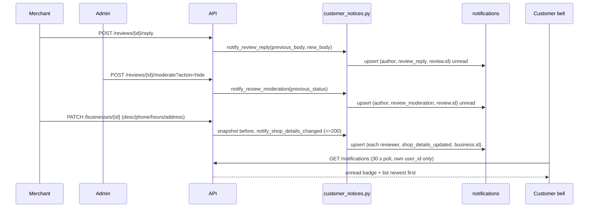

# Slice: S-126 — Customer notifications for review replies, review moderation and shop edits

| Field | Value |
|-------|-------|
| **Slice ID** | S-126 |
| **Phase** | 4 Dashboards (extends the S-008 / S-015 / S-065 notification bell) |
| **Status** | Specified |
| **Role(s)** | customer (receives), merchant and admin (trigger) |
| **Owner** | PM / 2026-11-08 |
| **Priority** | P1 — closes three README §14 known gaps and turns S-125's `_gap` tests green |

---

## Context

Today the bell is merchant-only (6 scenarios, one row per `(user, scenario)`, README §5). S-125 proved
three silent moments: a merchant replies to a review, an admin hides/removes a review, a merchant edits
an approved shop. Customers are told nothing. Decisions already made: AI output stays a suggestion
(nothing here is AI-generated); email is optional and **out of scope**; notices appear in the existing
bell; a customer only ever hears about their **own** review or a shop they **reviewed**.

---

## User story

**As a** customer who reviewed a local shop
**I want** the bell to tell me when the owner replies to my review, when an admin hides or removes it,
and when a shop I reviewed changes its details
**So that** I am not left guessing about my own review and I trust the shop information I relied on

---

## Acceptance criteria

### A — Review reply

1. **Given** an approved shop and a customer's active review, **when** the shop's merchant posts a first
   reply, **then** that customer gets one unread notice naming the shop; the merchant and other customers get none.
2. **Given** a reply already exists, **when** the merchant saves a reply with a **different** text,
   **then** the author's notice for that review becomes unread again (not a second row); **when** the
   same text is saved again, **then** nothing changes and nothing is sent.
3. **Given** the review is not active (hidden, removed, or held as reported), **when** the merchant replies,
   **then** no notice is sent (the reply is not publicly visible).

### B — Admin moderation

4. **Given** a customer-authored review, **when** an admin **hides** it, **then** the author gets an unread
   notice saying it was hidden by moderators, naming the shop.
5. **Given** a customer-authored review, **when** an admin **removes** it, **then** the author gets an
   unread notice saying it was removed, naming the shop.
6. **Decision — restore:** **when** an admin **restores** a hidden review, **then** the author gets an
   unread "your review is visible again" notice that **replaces** the hide notice for that review
   (no stale "hidden" text left). Restoring a never-hidden/active review sends nothing.
7. **Given** a review is auto-held by the profanity/spam flag at submit (status reported) or reported by
   another user, **when** that happens, **then** no notice is sent to anyone as a result of the report itself.
   Only the later explicit admin action (AC 4-6) notifies.

### C — Shop edit (reviewers)

8. **Given** an approved shop with N customers who have an active review on it, **when** the merchant saves
   a change to **description, phone, business hours, or address (street/city/state/postal/country)**,
   **then** each of those N customers gets one unread notice naming the shop. Customers who never reviewed
   it, and reviewers whose review is hidden/removed, get none.
9. **Given** a save whose values equal what is stored (no-op), or that changes only name, website, email,
   categories or coordinates, **when** it succeeds, **then** nobody is notified.
10. **Given** a merchant saves several edits in a row, **when** a reviewer opens the bell, **then** they
    see one notice per shop showing the latest wording, unread.
11. **Given** a pending (not yet approved) shop, **when** it is edited, **then** nobody is notified.

### D — Isolation and actors

12. **Given** any notice in A-C, **when** it is listed, **then** it contains only the shop name, the
    review's own author context and fixed copy — never another user's name, email, review text from
    someone else, or the merchant's contact/ID data. A user can never read or mark-read another user's notice (403/404).
13. **Given** the actor is also the recipient (merchant reviewing their own shop; an admin who authored
    the moderated review), **when** they trigger the event, **then** they get no notice for it.
14. **Given** a customer reviewed several shops (or has several reviews), **when** a second notice
    arrives about a **different** shop or review, **then** the earlier unread notice is **still in the
    list** — each shop (edits) and each review (reply, hide/remove/restore) keeps its own entry, and a
    new event about the **same** shop/review refreshes that entry rather than adding a duplicate.
    Key design is the Architect's; this requirement is user-visible behaviour.
15. **Given** a notice for a reply and a notice for a hide on the **same** review, **then** both
    are separately visible (different kinds do not overwrite each other).
16. **Given** the six existing merchant scenarios, **when** this slice ships, **then** their behaviour,
    copy and tests (`test_notification_scenarios.py`) are unchanged.

### E — Bell experience

17. **Given** a customer with a new notice, **when** the page polls (every 30 s) or they reload, **then**
    the unread badge count includes it; **when** they open the dropdown, **then** the notice is listed
    unread, newest first; **when** they mark it read (or mark all read), **then** the badge drops and it
    shows as read. A later event for the same shop/review makes it unread again.
18. **Given** a customer with no notices, **then** the bell shows the existing empty state (no new UI).

### F — Tests and tracking

19. **Given** the S-125 chain tests `test_wf_review_reply_gap` and `test_wf_shop_edit_gap`, **when** this
    slice is done, **then** the `xfail(strict)` marks are removed, they are renamed without the `_gap`
    suffix (or merged into the main chain), and they **pass** on a `web-workflows.yml` run
    (`wf-review-reply`, `wf-shop-edit`). The `wf-review-moderation` customer-side check is added to that
    chain the same way (passes, not xfail).
20. **Given** README, **when** the slice is Accepted, **then** §5 (scenarios table), §7 (notifications
    list semantics), §11 (index row + chain note at the `wf-*` table), §12 (new parity row) and §14
    (three gaps removed) are updated in the same PR.

---

## UX notes

- Screens / routes: existing navbar `NotificationBell` dropdown only; no new route. Notices are plain text, no deep link (shared gap M-46).
- Copy (one line each, hedged, no blame):
  - Reply: "{Shop} replied to your review."
  - Hidden: "Your review of {Shop} was hidden by our moderators."
  - Removed: "Your review of {Shop} was removed by our moderators."
  - Restored: "Your review of {Shop} is visible again."
  - Shop edit: "{Shop} updated its details (description, phone, hours or address)."
- Figma (mobile `rk4RnruVFTpKdIsgGJIt9w`): reuse the existing Notifications tab frame (default / empty / loading / error); no new frame, no new states.
- Mobile placement: existing Notifications tab (M-44/M-45). **Mobile: DEFERRED** for any mobile-specific work — no Flutter changes in this slice. Because the list API is shared the notices should simply render; add a README §12 row "Customer notices (reply / moderation / shop edit)" as `partial` (shows in the existing list; no mobile test, no deep link, no push).
- Components to reuse: `NotificationBell`, existing notification list item.
- Empty states / errors: unchanged.
- AI disclaimer required? No — no AI content is shown. (Sentiment/AI wording is never part of these notices.)

---

## Out of scope

- Email or push for these events (mock in Compose; best-effort later slice).
- Opt-out / notification preferences.
- Deep links from a notice to the shop or review (shared gap M-46).
- Notifying about name/website/email/category changes, new photos, or pending-shop edits.
- Notifying favoriters or people who only viewed the shop.
- Notifying a customer when their review is reported by someone else, or of AI sentiment results.
- Mobile-specific UI, tests or push (deferred; §12 row records it).
- Batch/digest or rate-limit of notices.

---

## Dependencies

- S-065 notification scenarios and S-015 bell (Accepted) — behaviour of the six merchant scenarios must not change.
- S-125 (Specified/Accepted) — supplies the chain tests that must flip; a `web-workflows.yml` run is the evidence.
- S-123 partner reviews: reviewers without an account cannot be notified (see open question).

---

## Definition of done (PM)

Full-cycle checklist: `CLAUDE.md` "Definition of done (full cycle)". Slice-specific:

- [ ] All 20 AC mapped to named tests in `TR-S-126` (backend: extend `test_notification_scenarios.py` + new customer-notice cases; `test_notifications.py` for isolation; web: existing `NotificationBell` test for customer rows; e2e: `wf-review-reply`, `wf-shop-edit`, `wf-review-moderation` in `backend/tests/e2e/chains/`)
- [ ] Both `_gap` xfail tests pass normally; no `xfail` left for these in `chains/`
- [ ] README §5 / §7 / §11 / §12 / §14 updated in the same PR (and §16 if investor-visible)
- [ ] UX copy matches the five lines above
- [ ] PM Status set to **Accepted**

---

## Technical specification (Architect)

> Architect, 2026-11-08. Decisions are inline (no ADR): the schema change is one additive, reversible column,
> and every other choice reuses existing patterns. Code investigated: `services/notifications.py`,
> `models/__init__.py` (`Notification`, `NotificationType`, `Review`, `Business`), migration `j4k5l6m7n8o9`
> (created `uq_user_notification_scenario`), `routers/reviews.py`, `routers/businesses.py`,
> `routers/notifications.py`, `services/partner_service.py`, `NotificationBell.tsx`, mobile
> `notifications_screen.dart`, `tests/e2e/chains/*`.

### Decisions (answers to the PM questions)

**1. Notice key (replaces unique `(user_id, scenario)`).** Add `notifications.dedupe_key VARCHAR(64) NOT NULL
DEFAULT ''` and make the unique constraint `(user_id, scenario, dedupe_key)`. Not a nullable column with
`coalesce(...)`: a NOT NULL empty-string default needs no expression index, is a plain
`UniqueConstraint` in the model, and keeps `upsert_notice`'s `WHERE user_id=? AND scenario=? AND
dedupe_key=?` made of simple equality clauses, which is what the in-memory `FakeDB._matches` in
`tests/test_notification_scenarios.py` understands (it reads `clause.right.value`; an `IS NULL`
or `coalesce` clause would break that file and violate AC 16). The six merchant scenarios never pass a key, so they
store `''` and behave exactly as today. Customer notices pass the entity id as the key.

- Existing rows: `ADD COLUMN ... NOT NULL DEFAULT ''` fills every existing row with `''` (metadata-only on
  PostgreSQL 11+; no UPDATE, no pruning needed, no row can violate the wider constraint).
- Migration file: `backend/alembic/versions/20261108_1000-o9p0q1r2s3t4_add_notification_dedupe_key.py`
  (`down_revision = "n8o9p0q1r2s3"`; Builder runs `alembic heads` and confirms exactly one head before and after).

```python
revision = "o9p0q1r2s3t4"
down_revision = "n8o9p0q1r2s3"

def upgrade() -> None:
    op.add_column(
        "notifications",
        sa.Column("dedupe_key", sa.String(length=64), nullable=False, server_default=""),
    )
    op.drop_constraint("uq_user_notification_scenario", "notifications", type_="unique")
    op.create_unique_constraint(
        "uq_user_notification_scenario_key", "notifications", ["user_id", "scenario", "dedupe_key"]
    )

def downgrade() -> None:
    # Keyed rows are the S-126 customer notices; several per (user, scenario) cannot fit the old
    # constraint. Downgrade deliberately drops them (they are transient bell items, not records).
    op.execute(sa.text("DELETE FROM notifications WHERE dedupe_key <> ''"))
    op.drop_constraint("uq_user_notification_scenario_key", "notifications", type_="unique")
    op.drop_column("notifications", "dedupe_key")
    op.create_unique_constraint("uq_user_notification_scenario", "notifications", ["user_id", "scenario"])
```

Model (`models/__init__.py`, `Notification`): add
`dedupe_key: Mapped[str] = mapped_column(String(64), nullable=False, default="", server_default="")` and replace
`__table_args__` with `UniqueConstraint("user_id", "scenario", "dedupe_key", name="uq_user_notification_scenario_key")`.
No schema (`NotificationResponse`) change: `dedupe_key` is internal and is **not** returned.

New `upsert_notice` signature (`services/notifications.py`; only addition is the last keyword; all existing
callers unchanged):

```python
async def upsert_notice(
    db: AsyncSession, *, user_id: UUID, scenario: str, ntype: NotificationType,
    title: str, message: str, extra_data: dict[str, Any] | None = None,
    dedupe_key: str | None = None,          # None -> '' (legacy one-row-per-scenario behaviour)
) -> Notification
```
It normalises `key = dedupe_key or ""`, selects with the third equality clause, and passes `dedupe_key=key` on
insert (the explicit value matters: a Python-side column default is not applied until flush, and the fake db
reads the attribute before that).

New constants in `notifications.py` (kept **out of** the existing `SCENARIOS` tuple, because
`test_notification_scenarios.py` zips `SCENARIOS` against its six cases and asserts `set(SCENARIOS)`; AC 16 says
that file is unchanged):

| Constant / value | Key (`dedupe_key`) | `NotificationType` | Meaning |
|------------------|--------------------|--------------------|---------|
| `SCENARIO_REVIEW_REPLY = "review_reply"` | `str(review.id)` | `REPLY` | merchant replied / edited the reply |
| `SCENARIO_REVIEW_MODERATION = "review_moderation"` | `str(review.id)` | `MODERATION` | admin hid / removed / restored |
| `SCENARIO_SHOP_DETAILS_UPDATED = "shop_details_updated"` | `str(business.id)` | `SYSTEM` | shop description/phone/hours/address changed |

`CUSTOMER_SCENARIOS` tuple lists these three.

**2. Refresh-to-unread.** `upsert_notice` already sets `is_read=False`, new `title/message/extra_data` and
`created_at=now` on the existing row, so list order (newest first) and unread badge follow with no change.
Keying works per AC: reply = one row per review (AC 2, 14); moderation = **one** `review_moderation` row per review
whose wording is overwritten by the latest of hide / remove / restore (so a restore replaces the stale "hidden"
text, AC 6, and hide then remove shows only "removed"); shop edit = one row per shop (AC 10, 14). Reply and
moderation use different scenario strings so they coexist for the same review (AC 15).

**3. No-op detection (all in `services/customer_notices.py`, pure functions, unit-tested).** Compare normalised
before/after snapshots; the stored values are still written exactly as sent (normalisation is only for deciding
whether to notify).

| Group | Fields | Normalisation |
|-------|--------|---------------|
| description | `description` | `None` == `""`; strip; collapse whitespace runs to one space; **case-sensitive** |
| phone | `phone` | `None` == `""`; keep only digits and a leading `+` (so `+91 98765-43210` == `+919876543210`) |
| hours | `business_hours` (JSONB dict) | `None`/`{}` equal; recursively: dict keys `str(k).strip().casefold()`, drop entries whose value is `None`/`""` (same filter as `BusinessHours.tsx`), string values strip + collapse + casefold, lists element-wise, other scalars as-is; compared as dict (key order irrelevant) |
| address | `address, city, state, postal_code, country` | each: `None` == `""`; strip; collapse; `casefold()`; group changes if any field differs |

Not in the snapshot, so never trigger: `name`, `website`, `email`, `category_ids`, `latitude`, `longitude`, photos,
`address_edit_count` (AC 9). Do not touch the existing raw `!=` check that drives the address OTP gate
(`address_changed` in `update_business`): it keeps its current semantics.

The web form (`BusinessForm.tsx` `toUpdatePayload`) sends the **whole** form on every save (name, description,
address, city, state, postal_code, country, phone, email, website, category_ids; no hours; blank description is
omitted), so most real saves resend identical values: snapshot-diff against the stored row is mandatory, not
"which keys were in the payload". Reply edit no-op: previous vs new reply `body` after strip + whitespace collapse,
case-sensitive (AC 2).

**4. Fan-out = synchronous, same transaction, bounded.** `update_business` has no BackgroundTasks and `get_db`
commits on exit, so doing the upserts inline means the notices and the edit commit or roll back together and the
FastAPI >= 0.162 ordering problem (PR #90) cannot occur. Bound: `MAX_SHOP_EDIT_FANOUT = 200` recipients, chosen as
the 200 most recent active, non-partner reviews (`ORDER BY reviews.created_at DESC LIMIT 201`; if 201 come back,
truncate and `logger.warning("shop edit fan-out truncated", business_id=..., cap=200)`, no PII). Cost is at most
about 400 simple statements in one request, only on edits that change one of the four groups. Recipient query is
isolated in one private function `_active_reviewer_ids(db, business_id, exclude_user_id, limit)` so tests can stub it
and a later slice can swap it. **If it must ever move to a background task** (more than 200 reviewers, or
email): first `await db.commit()`, then `background_tasks.add_task(...)` that opens its **own** session
(`AsyncSessionLocal`), exactly the sequence and comment in `create_review` / `submit_token_review`. Never
reuse the request session in a task.

**5. Partner-channel authors.** Yes, they have a `User` row, but it is a login-less shadow user
(`partner_service._resolve_shadow_user`: `full_name=SHADOW_USER_NAME`, no email, no password,
`auth_provider="partner"`). Nobody can ever open that bell, so writing rows is dead weight and would burn the 200-row
cap. Rule: **skip every review with `Review.source == "partner"`** (reply, moderation, shop edit). `source` is on the
review row already loaded, so no extra query. This resolves the PM's open question: reviewers without an account are
not notified, by design.

**6. Where the logic lives.** `services/notifications.py` keeps the primitive (`upsert_notice` + constants).
New `backend/app/services/customer_notices.py` holds the rules (so S-065's "merchant scenario" module stays
focused and there is no import cycle with `Review`/`Business`). Routers stay thin: one call each, after the
mutation.

```python
MAX_SHOP_EDIT_FANOUT = 200
def normalise_text(v) -> str; def normalise_phone(v) -> str; def normalise_hours(v) -> dict
def snapshot_shop_details(business: Business) -> dict[str, object]      # {"description","phone","hours","address"}
async def notify_review_reply(db, *, review, business, actor_id, previous_body: str | None, new_body: str) -> bool
async def notify_review_moderation(db, *, review, business, admin_id, previous_status, action: str) -> bool
async def notify_shop_details_changed(db, *, business, before: dict, actor_id) -> int   # returns recipients
```
Rules (each returns False/0 without writing when it does not apply):

- **Reply** (`reply_to_review`): skip if `review.source == "partner"`, `review.status != ACTIVE` (AC 3), `review.author_id == actor_id`
  (AC 13), or `previous_body` is not None and normalised equal to `new_body` (AC 2). Otherwise upsert
  `review_reply` / key `str(review.id)` for `review.author_id`. Capture `previous_body` **before** the router assigns
  `review.reply.body`.
- **Moderation** (`moderate_review`): capture `previous_status` before assignment; load `business` with `db.get`
  (if `None`, skip). Skip when partner source, `author_id == admin_id` (AC 13), or `new == previous`. `hide` -> HIDDEN,
  `remove` -> REMOVED, `restore` -> ACTIVE; a `restore` notifies **only** if `previous_status in {HIDDEN, REMOVED}`
  (restoring ACTIVE or REPORTED sends nothing, AC 6). Upsert `review_moderation` / key `str(review.id)` with the
  matching copy. `report_review` and the profanity flag in `create_review` get **no** code change (AC 7 holds
  because they never call this module). Invalid `action` still 400s before any notice.
- **Shop edit** (`update_business`): `before = snapshot_shop_details(business)` taken before the `setattr` loop; after the
  loop and category changes call `notify_shop_details_changed`. It no-ops unless `business.status == APPROVED` (AC 11)
  and `snapshot(after) != before`; recipients = `_active_reviewer_ids` (reviews `ACTIVE`, `source != "partner"`,
  `author_id != actor_id`, one per author by `uq_author_business_review`); upsert `shop_details_updated` / key
  `str(business.id)`. `extra_data["changed"]` lists the group names that differed (`description|phone|hours|address`).

**Copy** (title / message, titles chosen by Architect, messages are the PM's five lines):
| Scenario | title | message |
|----------|-------|---------|
| reply | `Reply to your review` | `{Shop} replied to your review.` |
| hidden | `Your review was hidden` | `Your review of {Shop} was hidden by our moderators.` |
| removed | `Your review was removed` | `Your review of {Shop} was removed by our moderators.` |
| restored | `Your review is visible again` | `Your review of {Shop} is visible again.` |
| shop edit | `Shop details updated` | `{Shop} updated its details (description, phone, hours or address).` |

`extra_data` shapes (plus the `scenario` key that `upsert_notice` always adds): reply `{review_id, business_id}`;
moderation `{review_id, business_id, action: "hide"|"remove"|"restore"}`; shop edit `{business_id, changed: [...]}`.
Ids only: no slug, no names of other people, no review text, no merchant contact data (AC 12). No slug on purpose:
see mobile note below.

**7. Clients render the new values.** Web: `Notification` in `frontend/src/lib/api.ts` is
`type: string; scenario?: string|null; extra_data?: Record<string, unknown>|null`, and `NotificationBell.tsx` only renders
`n.title` and `n.message` keyed by `n.id`: nothing to change. Mobile: `NotificationResponse.type` is a plain `String`, `extraData` a
`JsonObject?`, and `notifications_screen.dart` reads only title / message / `isRead` / `createdAt`; its tap handler
`_looksLikeReview` matches the word "review" in type+title+message, so reply and moderation notices will, on tap,
go to `/businesses` (customer) or `/merchant/reviews` (a merchant who reviewed another shop) because
`extra_data` carries no slug. This is harmless and is existing behaviour for any "review" text; the §12 row says
"no deep link". **No Flutter change in this slice.** **`NotificationType` is sufficient:** the PostgreSQL enum
`notificationtype` already contains `REVIEW, REPLY, APPROVAL, MODERATION, SYSTEM` (initial migration
`3a5749360a88`; SQLAlchemy stores enum **names**) and `REPLY`/`MODERATION` are unused today. So no enum migration.
(If a value is ever needed: `ALTER TYPE notificationtype ADD VALUE 'NEWVALUE'` cannot run inside a transaction block, so it
needs `with op.get_context().autocommit_block():` in the migration, and it cannot be dropped on downgrade. Avoid.)

**8. Isolation.** `GET /notifications` filters `Notification.user_id == user.id`; `POST /{id}/read` only mutates when
`notification.user_id == user.id`; `POST /read-all` is `UPDATE ... WHERE user_id = user.id`. All strictly scoped. One
wording mismatch: a foreign or unknown id on `read` currently returns **200 with no state change** (existing
tests `test_does_not_mark_another_users_notification`, `test_unknown_id_is_a_no_op_not_an_error` pin it), not
403/404 as AC 12 says. Recommendation: keep the behaviour (no existence oracle, mobile relies on it) and reword AC 12
to "can never read or change". See Open decisions. Also note `GET` is `LIMIT 50`: a user with more than 50
reviews/shops sees only the newest 50 notices (and the web badge, which counts the unread list, caps at 50);
acceptable, listed in Risks.

**9. Can an admin author a review?** Yes. `create_review` is `require_roles(CUSTOMER, MERCHANT, ADMIN)`; only a
merchant reviewing their *own* shop is blocked. So recipients of any of the three notices can be customer, merchant or
admin accounts; the `User` role never gates delivery. AC 13 therefore guards `author_id == actor_id` in all three
functions (an admin who authored the moderated review, an owner-reviewer, an admin who edits a shop they reviewed).

**10. Flipping the S-125 chain tests.** `summary.py` marks `is_gap` purely by `test_name.endswith("_gap")` and
`chain_status` treats non-gap tests as "main". Recommendation: **delete the two `_gap` tests and fold the
customer-notified assertion into the main chain test** (stronger: a single run proves visibility + notification, no
`xfail`, no name suffix):

- `test_wf_review_reply`: it already returns `tokens` from `_author_with_review`; after the public-page step add
  `author = wf.session_actor(tokens.access_token, tokens.refresh_token); author.goto("/"); wf.skip_scan("/");
  bell_expect(author, contains=biz.name, title="Reply to your review", chain=chain, role="review author")`.
- `test_wf_shop_edit`: before the merchant edit register a customer + `api.create_review` (reuse the lines from the old
  gap test), after the PATCH assert `bell_expect(reviewer, contains=biz.name, title="Shop details updated", ...)`.
  The edit is a description change, so no address OTP.
- `test_wf_review_moderation`: keep `author` (already created); after the admin hides it add the author's bell assertion
  with `title="Your review was hidden"`.
- Remove `pytest.mark.xfail` blocks, the `_gap` functions, and the "Known gap" module docstrings. Update the
  `bell_expect` docstring in `chains/helpers.py` ("One row per (user, scenario) is overwritten") to mention keyed rows
  (still assert on the per-run unique business name, never on counts).
- `chains/summary.py` and `tests/test_workflow_summary.py`: **no change required.** `is_gap`, `KNOWN_GAP` and the
  XPASS message remain valid for future gaps, and the unit tests use synthetic names (`test_wf_r_gap`), not the real
  chain files. (After the flip no chain reports KNOWN-GAP; do not delete the mechanism.)
- README §11 chain table row for `wf-review-reply, wf-shop-edit` becomes "Full chain", and the "Chains that exist
  today" table gains three rows.
- Evidence for AC 19: a `web-workflows.yml` dispatch with `suite=wf-review-reply`, `wf-shop-edit`, `wf-review-moderation`
  (one run each, workflow is dispatch-only).

### API contract

No new endpoints, no request/response schema changes (README §7 style: behaviour notes only).

| Method | Path | Auth | Request | Response / change |
|--------|------|------|---------|-------------------|
| GET | `/api/v1/notifications` | Bearer (any role) | `?unread_only` | Unchanged shape. May now contain `scenario` in `review_reply`, `review_moderation`, `shop_details_updated`; `type` in `reply`, `moderation`, `system`; up to 50 rows, newest first. One row per `(scenario, dedupe_key)` |
| POST | `/api/v1/notifications/{id}/read` | Bearer | - | Unchanged (200, no-op for foreign/unknown id) |
| POST | `/api/v1/notifications/read-all` | Bearer | - | Unchanged |
| POST | `/api/v1/reviews/{id}/reply` | Merchant (owner) | `ReplyCreate` | Unchanged 201; **side effect:** `review_reply` notice for the author when rules above pass |
| POST | `/api/v1/reviews/{id}/moderate?action=hide\|restore\|remove` | Admin | - | Unchanged 200/400/404; **side effect:** `review_moderation` notice |
| PATCH | `/api/v1/businesses/{id}` | Merchant (owner), Admin | `BusinessUpdate` | Unchanged 200; **side effect:** `shop_details_updated` notices (<= 200 reviewers), only for an approved shop and a real change |

Failure semantics: notice writes share the request transaction, so if they raise, the primary action fails and rolls
back (same as the existing `new_review` notice). No email, no AI call, no new external integration.

### RBAC matrix

| Action | customer | merchant | admin |
|--------|----------|----------|-------|
| List / read / read-all **own** notices | yes | yes | yes |
| Read another user's notice | no (200 no-op on `read`; absent from list) | no | no |
| Receive reply / moderation notice (as review author, non-partner) | yes | yes (if they reviewed another shop) | yes (if they authored a review) |
| Receive shop-edit notice (as active reviewer) | yes | yes (as reviewer of another shop) | yes (as reviewer) |
| Trigger reply notice (`POST /reviews/{id}/reply`) | no (403) | owner only | no (403, `require_roles(MERCHANT)`) |
| Trigger moderation notice | no | no | yes |
| Trigger shop-edit notice (`PATCH /businesses/{id}`) | no | owner only | yes (Open decision 3) |
| Notified about own action (actor == recipient) | n/a | never | never |

### Data model impact

- [ ] None  [x] Extend existing  [ ] New table(s)

**Details:** `notifications.dedupe_key VARCHAR(64) NOT NULL DEFAULT ''`; drop
`uq_user_notification_scenario (user_id, scenario)`; add `uq_user_notification_scenario_key (user_id, scenario,
dedupe_key)`. No enum change. No other table touched. ERD: no new entity or relationship; update README §5
`notifications` row, the "Indexes & constraints" unique-pair line (README ~l.647), the relationship line "One row per
`scenario` per user", and the "Notification scenarios" table (+3 rows, note on `dedupe_key`). Seed script needs no
change (`Notification` rows, if any, get `dedupe_key=''`).

### Cache / side effects

- Redis: none. Notices do not affect `search:*`; the existing `cache_delete_pattern("search:*")` in `update_business`
  stays as is. (`moderate_review` has never invalidated search; out of scope.)
- No email, SMS, push, AI or storage calls (no abstraction layer touched; no AI text in any notice).
- Same-transaction writes; no BackgroundTasks, so PR #90's commit-before-task rule is not triggered. If a task is ever
  added, apply it (see Decision 4).
- Existing `FakeDB`-based tests (`test_reviews.py`, `test_business_address_reverify.py`,
  `test_businesses_cache_invalidation.py`) drive the changed handlers directly. The new calls add `db.get(Business, ...)`
  and `select(...)`/`db.add` of `Notification`; the Builder must run those files and fix any fake that cannot answer
  the new statements (the notice helpers already tolerate `business is None` by skipping).

### Frontend

- **Route:** none new (navbar `NotificationBell` only).
- **Rendering:** CSR (existing `"use client"` component). No change.
- **Components:** reuse `NotificationBell`; add a Jest case only. Mobile untouched (see Decision 7).

### Flow



### Exact files to change

| File | Change |
|------|--------|
| `backend/app/models/__init__.py` | `Notification.dedupe_key` + new `UniqueConstraint` |
| `backend/alembic/versions/20261108_1000-o9p0q1r2s3t4_add_notification_dedupe_key.py` | new migration (above) |
| `backend/app/services/notifications.py` | `dedupe_key` param; 3 scenario constants + `CUSTOMER_SCENARIOS`; docstring "one notice per scenario per entity" |
| `backend/app/services/customer_notices.py` | **new**: normalisers, snapshot, three notify functions, `_active_reviewer_ids` |
| `backend/app/routers/reviews.py` | `reply_to_review` (capture previous body, call notify, both branches); `moderate_review` (capture previous status, load business, call notify) |
| `backend/app/routers/businesses.py` | `update_business` (snapshot before `setattr`, notify after categories, before cache invalidation) |
| `backend/tests/test_customer_notices.py` | **new** (below) |
| `backend/tests/test_notifications.py` | 2 isolation cases |
| `backend/tests/e2e/chains/test_wf_review_reply.py`, `test_wf_shop_edit.py`, `test_wf_review_moderation.py`, `helpers.py` | flip as in Decision 10 |
| `frontend/src/components/__tests__/NotificationBell.test.tsx` | customer-notice case |
| `README.md` | §5, §6 (cross-role paragraph + chain table, ~l.2261-2286), §7 (l.1465), §11 (index row l.2205 + chain table l.2286), §12 (new row; next free id after M-95), §14 (remove the 3 gaps), §16 if investor-visible |
| `docs/agents/test-plans/TP-S-126-*.md`, `test-reports/TR-S-126-*.md` | Tester |

No change to `NotificationBell.tsx`, `lib/api.ts`, `schemas/__init__.py`, `summary.py`, `test_workflow_summary.py`,
`test_notification_scenarios.py` (must stay green and untouched), or anything under `mobile/`.

### Tests per AC (names for README §11 index)

Backend, new `backend/tests/test_customer_notices.py` (FakeDB style as `test_reviews.py` / `test_notification_scenarios.py`; call handlers directly):

| AC | Test(s) |
|----|---------|
| 1 | `test_reply_first_notifies_author_only` |
| 2 | `test_reply_edit_different_text_refreshes_same_row`, `test_reply_edit_same_text_is_noop`, `test_normalise_text` |
| 3 | `test_reply_on_non_active_review_sends_nothing[hidden\|removed\|reported]` |
| 4 | `test_moderate_hide_notifies_author` |
| 5 | `test_moderate_remove_notifies_author` |
| 6 | `test_moderate_restore_replaces_hide_notice`, `test_moderate_restore_of_active_or_reported_sends_nothing`, `test_moderate_repeat_action_sends_nothing` |
| 7 | `test_report_review_notifies_nobody`, `test_flagged_create_review_sends_no_customer_notice` |
| 8 | `test_shop_edit_notifies_active_reviewers_only[description\|phone\|hours\|address]` |
| 9 | `test_shop_edit_ignored_fields_notify_nobody`, `test_shop_edit_noop_and_cosmetic_whitespace_notifies_nobody`, `test_normalise_phone`, `test_normalise_hours` |
| 10 | `test_shop_edit_repeated_keeps_one_row_per_shop` |
| 11 | `test_shop_edit_pending_business_notifies_nobody` |
| 12 | `test_notice_payload_has_no_foreign_pii`; `test_notifications.py::test_list_returns_only_own_keyed_notices`, `::test_mark_read_ignores_foreign_keyed_notice` |
| 13 | `test_reply_actor_is_author_sends_nothing`, `test_moderate_own_review_by_admin_sends_nothing`, `test_shop_edit_excludes_actor_and_partner_authors` |
| 14 | `test_upsert_keyed_rows_do_not_overwrite_each_other`, `test_shop_edit_two_shops_keep_two_rows` |
| 15 | `test_reply_and_moderation_for_same_review_coexist` |
| 16 | `tests/test_notification_scenarios.py` (unchanged, all cases pass), `test_upsert_without_key_is_legacy_behaviour`, `test_notification_unique_constraint_columns` (model constraint columns/name) |
| bound / partner (Decision 4, 5) | `test_shop_edit_fanout_is_capped_at_200`, `test_reply_partner_review_sends_nothing` |
| 17 | `test_upsert_same_key_refreshes_and_marks_unread` (+ web case below) |

Web (Jest): `frontend/src/components/__tests__/NotificationBell.test.tsx` add
`renders customer notices (reply, moderation, shop edit) newest first with nested extra_data and no crash` (AC 14, 17) and keep
the existing render-with-empty-list test as AC 18. Run `npx jest src/components/__tests__/NotificationBell.test.tsx`.

E2E (Playwright, dispatch `web-workflows.yml`): `chains/test_wf_review_reply.py::test_wf_review_reply`,
`chains/test_wf_shop_edit.py::test_wf_shop_edit`, `chains/test_wf_review_moderation.py::test_wf_review_moderation` (AC 19). Affected
chain suites for the Tester's dispatch: `wf-review-reply`, `wf-shop-edit`, `wf-review-moderation`; also dispatch `wf-new-review`
and `wf-listing-approval` once as a regression for the unchanged merchant scenarios (AC 16). AC 20: reviewed by PM against
README diff, no test.

Mobile: no new test (deferred); regression only if `mobile/` is touched, which it is not.

### Security / privacy notes

- Notice content is fixed copy + shop name only; `extra_data` holds ids that the recipient already knows (their review, a shop they
  reviewed). The reviewer set is never exposed to the merchant, and reporter identity never reaches the author.
- All reads are `user_id`-scoped; there is no admin or cross-user read path to add.
- No new input surface: `dedupe_key` is always server-generated (UUID string), never from the request.
- Fan-out cap bounds the amplification a merchant could trigger by repeatedly editing (still unthrottled; AC out of scope "rate-limit").
- No secrets, no PII in logs (the truncation warning logs ids and counts only).
- README §9: no change needed beyond a one-line mention in §7 that notice reads are per-user.

### Open decisions (product owner)

1. **Fan-out cap of 200** (silent truncation to the 200 most recent active reviewers, logged). OK, or prefer unbounded via a
   background task (separate commit-then-task design, more moving parts)? Default: 200.
2. **AC 12 wording**: foreign/unknown notice id on `read` is a 200 no-op today (existing tests pin it). Reword AC 12 to "can never
   read or change another user's notice" (default) or require 403/404 (touches router, tests and mobile expectations).
3. **Admin edits**: `PATCH /businesses/{id}` also allows admin; default is that an admin changing the four fields **also**
   notifies reviewers. Say if only the merchant should trigger it.
4. **WhatsApp-applied drafts** (`whatsapp_ingest_service` approve) write the same fields (`description, address, business_hours,
   phone`) to the live shop but are **not** covered (PM scope says "merchant saves"). It would be a one-line reuse of
   `snapshot_shop_details` / `notify_shop_details_changed`; add as a follow-up or fold in?
5. **Restore of a REMOVED review** also sends "visible again" (router allows restore from any state). Default yes; say if only
   HIDDEN should.

### Build order (Builder, small steps; stop and run the named tests after each)

1. Model + migration + `upsert_notice(dedupe_key)` + 3 constants. Run: `alembic heads` (one head), `pytest tests/test_notification_scenarios.py tests/test_notifications.py`. Add the 3 `upsert`/constraint tests.
2. `customer_notices.py` normalisers + `snapshot_shop_details` with their unit tests (pure, no db).
3. Reply: `notify_review_reply` + wire `reply_to_review` + tests. Run `pytest tests/test_reviews.py tests/test_customer_notices.py`.
4. Moderation: `notify_review_moderation` + wire `moderate_review` + tests (incl. AC 7 negatives). Same run.
5. Shop edit: `_active_reviewer_ids`, `notify_shop_details_changed`, wire `update_business`, tests incl. cap. Run `pytest tests/test_business_address_reverify.py tests/test_businesses_cache_invalidation.py tests/test_customer_notices.py`.
6. Web Jest case. Run the NotificationBell test.
7. Flip the three chain tests and `helpers.py` docstring (import-check with `pytest --collect-only tests/e2e/chains -q`; they skip without `E2E=1`), plus `pytest tests/test_workflow_summary.py` (unchanged, must pass).
8. README §5/§6/§7/§11/§12/§14 (+§16). Local gates: `python scripts/check_agent_config_sync.py` if config files touched.
9. Branch + PR (never `main`); Tester dispatches `web-workflows.yml` for the suites named above.

### Architect checklist

- [x] API contract defined (no new endpoints; side effects and `GET /notifications` semantics stated; matches README §7 style)
- [x] RBAC matrix complete
- [x] Data model impact documented (`dedupe_key`, constraint swap, upgrade/downgrade; ERD/§5 updates listed)
- [x] Cache invalidation considered (none needed; `search:*` unchanged)
- [x] Uses AI/storage abstractions where applicable (not applicable: no AI, storage, maps, email in this slice)
- [x] ERD/API/FLOWS updates noted (README §5, §6, §7, §11, §12, §14)
- [x] No secrets in design

### Risks / tradeoffs

- **Race on first insert**: two concurrent first notices for the same `(user, scenario, key)` can raise `IntegrityError` and fail the
  caller's request (same exposure as every existing `upsert_notice` call). Window is tiny (same merchant double-submitting an edit).
  Hardening if ever seen: run the fan-out in `db.begin_nested()` and ignore the conflict, or `INSERT ... ON CONFLICT DO UPDATE`.
- **Notice failure fails the edit** (same transaction). Chosen for atomicity and to avoid the get_db-commit-after-tasks hazard.
- **Cap of 200** silently under-notifies very popular shops; logged. README §14 gets a one-line known limit.
- **Request latency** on a 200-reviewer edit (up to about 400 statements). Rare path; optimise with one prefetch SELECT later.
- **`LIMIT 50` list and badge** can hide older notices for heavy reviewers; unchanged endpoint behaviour.
- **Table growth**: bounded by number of (reviews + shops reviewed) per user; no pruning.
- **Downgrade deletes keyed notices** (documented).
- **Mobile tap** on review/moderation notices goes to the generic `/businesses` list (no slug), accepted; M-46 deep link stays a shared gap.
- **Existing FakeDB tests** may need small fake extensions for the new `db.get(Business)`/`select`.
- **Behaviour not covered**: WhatsApp-applied edits, name/website/category changes, suspension (all out of scope).

---

## Links

- Test plan: `docs/agents/test-plans/TP-S-126-*.md`
- Test report: `docs/agents/test-reports/TR-S-126-*.md`
- ADR: `docs/agents/adrs/ADR-XXX-*.md` (if any)

---

## Product-owner decisions (defaults accepted by the Builder, 2026-11-08)

The product owner asked for the slice to be finished end to end; the five Open decisions were resolved to the Architect's defaults and are to be confirmed by the PM at acceptance: (1) fan-out capped at 200; (2) AC 12 reads "can never read or change" another user's notice (a foreign id on `read` stays a 200 no-op); (3) an admin editing the four fields also notifies reviewers; (4) WhatsApp-applied drafts are a follow-up; (5) restoring a REMOVED review also sends "visible again".

## Changelog

| Date | Agent | Change |
|------|-------|--------|
| 2026-11-08 | PM | Created slice (Draft) |
| 2026-11-08 | Architect | Technical specification added; Status -> Specified (5 product-owner decisions listed in "Open decisions") |
